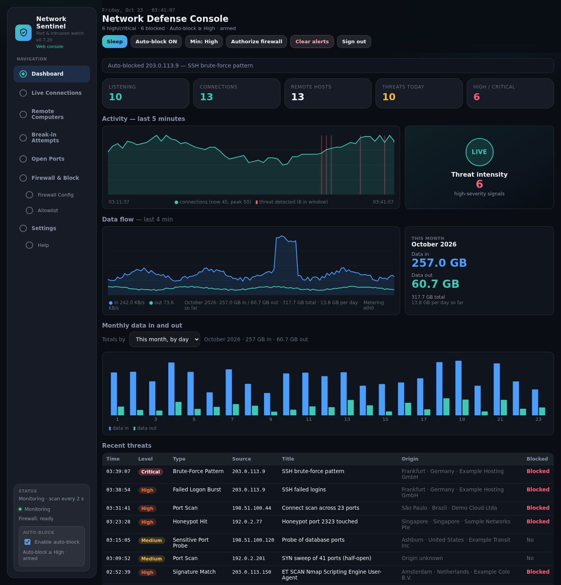
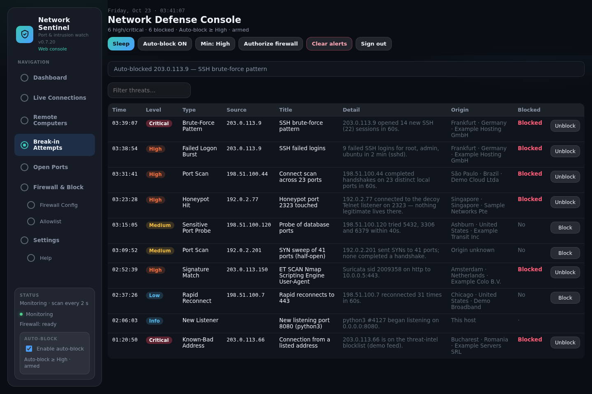
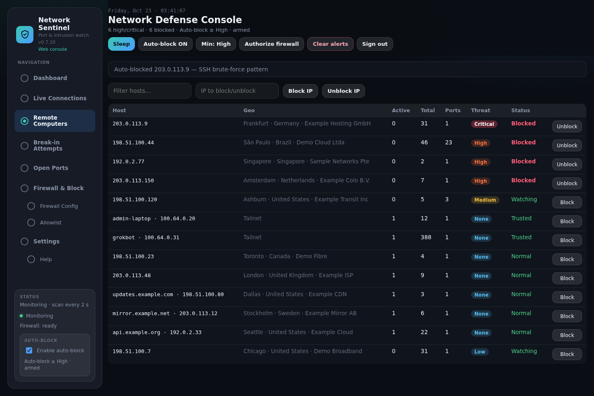
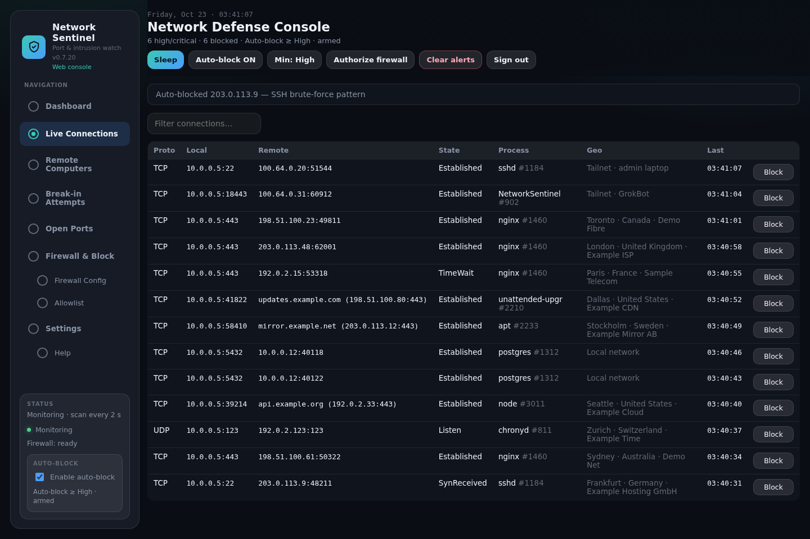
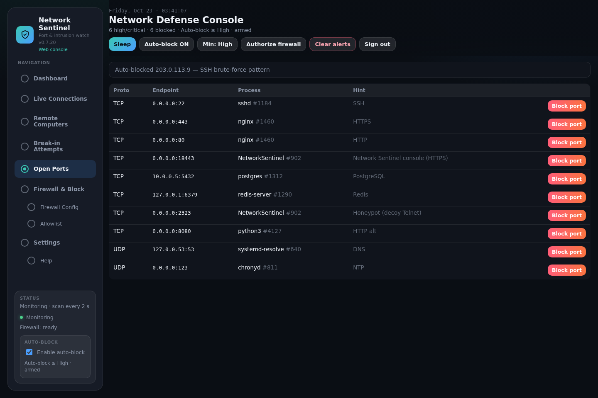
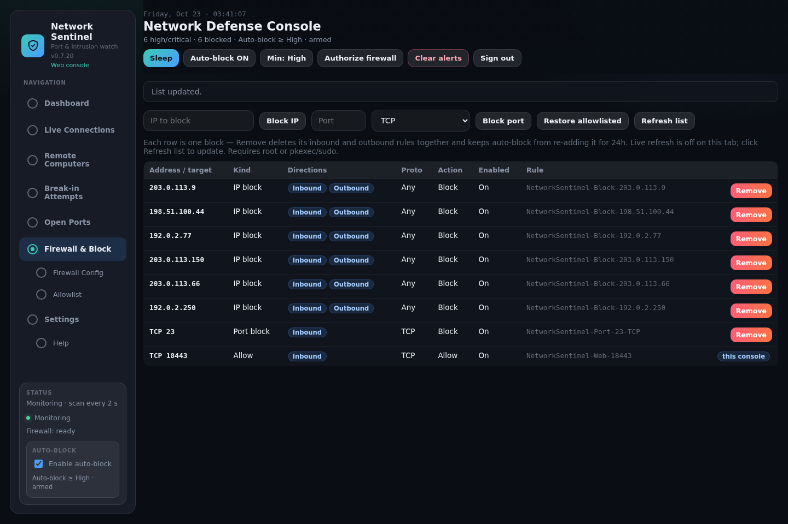
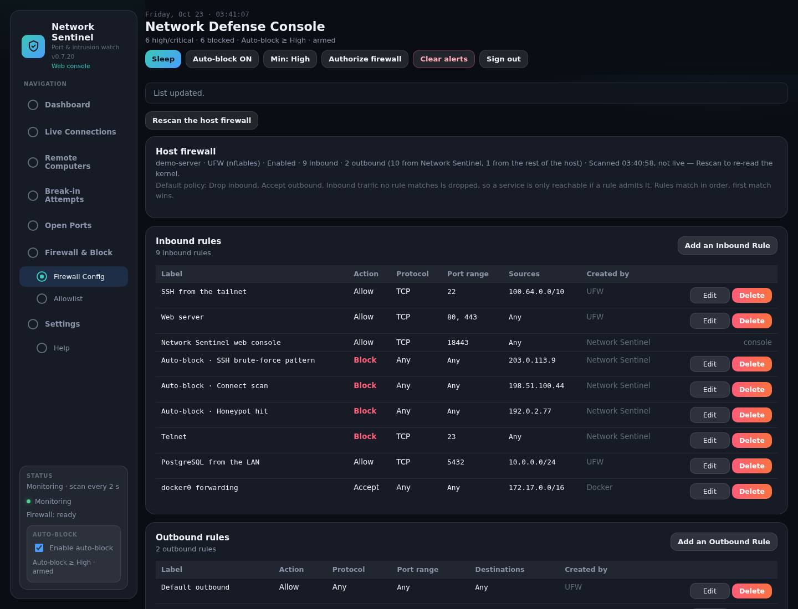
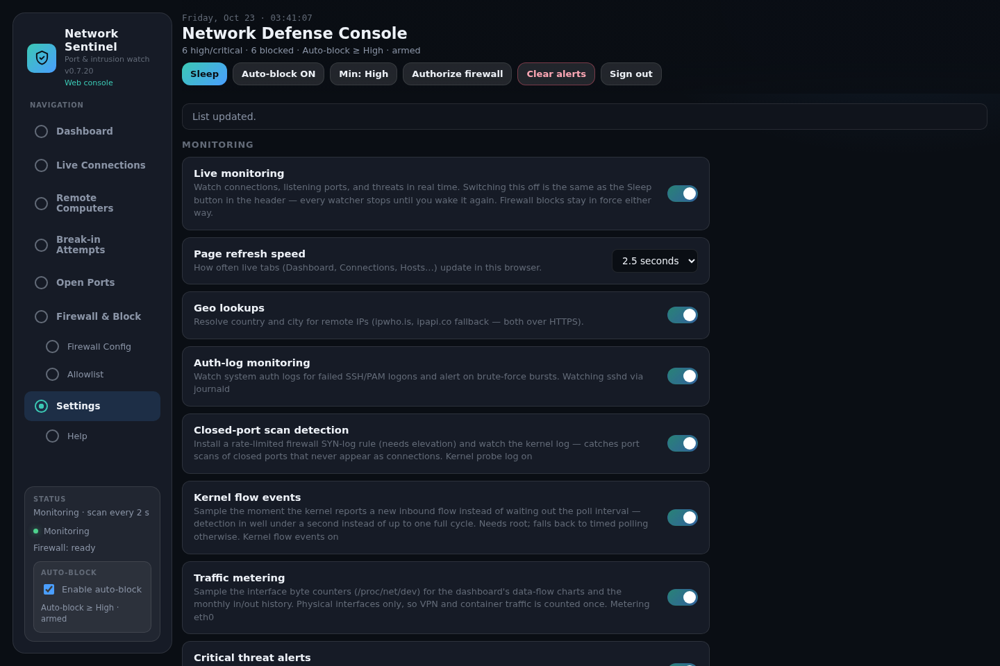

# Network Sentinel (Linux)

Native **Linux** app for **live network monitoring**, **remote peer tracking**, **break-in heuristics**, and **host firewall blocking**.

Three ways to run it:

| Mode | When to use |
|------|-------------|
| **Avalonia GUI** | Desktop with a display |
| **Terminal UI (`--tui`)** | SSH / keyboard-first |
| **Headless web UI (`-w`)** | Browser on a server (master-password protected) |

> **Host-based** intrusion detection and prevention. It detects on its own heuristics and, with Suricata attached (0.6.0), on signature/payload inspection — then enforces in the kernel via `nftables`. It is not an inline network appliance: it protects the machine it runs on, not a segment, and it does not sit in the forwarding path.

Linux port of the original Windows WPF Network Sentinel. Platform layers use `/proc/net`, `ss`, conntrack netlink, `nftables`/`iptables` (elevated via **pkexec**), and XDG data paths. Version **0.7.20**.

## Screenshots

The web console on a server. Every address in these is from a range reserved for documentation, and every name is invented.

**Dashboard:** live counts, activity, data flow, and the latest threats with whether each one was blocked.



**Break-in Attempts:** each threat with its detail, where it came from, and the block verdict.



<table>
  <tr>
    <td width="50%"><a href="docs/screenshots/hosts.png"></a><br><b>Remote Computers</b>: every address seen, its threat level, and Block or Unblock</td>
    <td width="50%"><a href="docs/screenshots/connections.png"></a><br><b>Live Connections</b>: who is connected right now, to which process</td>
  </tr>
  <tr>
    <td><a href="docs/screenshots/ports.png"></a><br><b>Open Ports</b>: what is listening, and a Block port button for each</td>
    <td><a href="docs/screenshots/firewall.png"></a><br><b>Firewall &amp; Block</b>: the rules Network Sentinel wrote, one row per block</td>
  </tr>
  <tr>
    <td><a href="docs/screenshots/fwconfig.png"></a><br><b>Firewall Config</b>: the whole host firewall, UFW's and Docker's rules included</td>
    <td><a href="docs/screenshots/settings.png"></a><br><b>Settings</b>: every detector, each with its own switch and status</td>
  </tr>
</table>

---

## Features

### Monitoring
| Area | What you get |
|------|----------------|
| **Open ports** | TCP listeners and UDP endpoints via `/proc/net/tcp{,6}` and `/proc/net/udp{,6}` |
| **Live connections** | Process name (via `/proc/*/fd` inode map), local/remote endpoints, TCP state, origin summary |
| **Remote computers** | Peers observed talking to this PC, reverse DNS, geo/ISP when public |
| **Activity chart** | Live sparkline of connection samples (GUI) |
| **Data-flow charts** (0.7.0) | Bytes in/out sampled from `/proc/net/dev`: live throughput, this month's totals, and paired bars per day or per month (GUI + web console since 0.7.1) |

### Threat awareness
Heuristics flag patterns such as:
- Multi-port scans / reconnaissance — fast (45 s window) **and slow/paced** (10 min window, catches `nmap -T1`-style scans)
- **Scans of closed ports** (opt-in) — a rate-limited firewall SYN-log rule makes probes visible that never appear as connections (the kernel answers closed-port SYNs with a RST before `/proc/net` ever sees them); a kernel-log watcher turns them into alerts within seconds
- SSH and SMB hammering
- **Failed logon bursts** from the system auth log (journald or `/var/log/auth.log`) — catches SSH/PAM brute-force even when it reuses one TCP session or paces below the connection-rate thresholds
- Sensitive-port probing (admin, DB, remote access)
- Short-lived / transitional TCP bursts
- **Outbound beaconing** — regular-interval new sessions to an uncommon remote port (C2 "calling home" signature); common client ports and LAN peers are excluded
- First-seen remote hosts — tracked **across restarts** (30-day persistent host history), so relaunching doesn't make every known peer look new again
- **UDP peers** — connected UDP sockets with a real remote address (from `/proc/net/udp{,6}`) count toward the scan/probe heuristics and the Remote Computers view; multicast/broadcast chatter (mDNS, SSDP) is excluded

### Intrusion detection (0.4.0)
| Detector | What it catches |
|----------|-----------------|
| **New-listener alerts** | A new port starts listening after the baseline (backdoor/implant signature), or a known port changes owner process (service replaced/impersonated). Baseline persists in `host-history.json`; loopback-only and ephemeral (49152+) listeners are skipped. Owner-change detection needs the socket→PID map, so it only works for sockets your user can see unless you run as root. |
| **Threat-intel blocklists** | Remote IPs checked against **FireHOL level1** and **Spamhaus DROP** (fetched daily over HTTPS, cached offline). A match is an instant **Critical** — those ranges are attack infrastructure. |
| **Process reputation** | Shells/interpreters (`bash`, `python`, `nc`, …) holding outbound connections to public hosts (reverse-shell signature, High); **fileless** processes running from `memfd` or a deleted binary staged in `/tmp` (High); binaries running from `/tmp`, `/dev/shm`, `~/Downloads` with network activity; **system** binaries that no installed package owns (`dpkg`/`rpm`/`pacman`/`apk`). Executable paths come from `/proc/PID/exe` — no per-poll shelling out, and package queries are cached per path off the poll loop. |
| **Honeypot decoy ports** (opt-in) | Binds decoy TCP ports (default `2323,3389,5900`). Nothing legitimate connects to a decoy, so any completed connection is a **zero-false-positive Critical**. Busy ports are skipped automatically. |
| **ARP / gateway watch** | The default gateway's MAC address changing (**Critical** — classic ARP-spoof MITM opener) or another LAN IP claiming the gateway's MAC (High). Reads `/proc/net/route` and `/proc/net/arp`; no elevation, no subprocess. |
| **Startup-item watch** | New or modified files under `/etc/systemd/system` (including `*.wants` symlinks), `~/.config/systemd/user`, `/etc/cron.d`, `/etc/cron.{hourly,daily,weekly,monthly}`, `/var/spool/cron`, `/etc/init.d`, `/etc/xdg/autostart` and `~/.config/autostart` — the standard persistence step right after a successful intrusion. Root-only folders are skipped when running unprivileged. |
| **Exfiltration monitor** | `ss -tinp` per-socket byte counters; alerts when outbound traffic to a single non-allowlisted public host exceeds a threshold (default **250 MB / 10 min**). LAN destinations (NAS backups) and allowlisted hosts stay quiet. TCP only — UDP/QUIC carries no equivalent kernel counter. |

Each alert includes **source IP**, **method**, and **where it’s coming from** (DNS + best-effort geo). Threat events and the host/listener baseline **persist across restarts** (`threat-log.jsonl`, `host-history.json`).

### Every warning says whether the address is blocked (0.6.5)

A warning that names an address and stops there sends you to the console to find out whether anything was actually done about it. So each batch of threats is run past the prevention engine **before** any alert about it leaves the machine, and the alert carries the verdict:

| Verdict | When |
| --- | --- |
| `BLOCKED — auto-block rule added` | A rule was just written for the address |
| `BLOCKED — a rule for this address is already in place` | It was already blocked |
| `NOT blocked — the firewall refused the rule: …` | A block was attempted and failed |
| `NOT blocked — dry run (it would have been blocked)` | Prevention is in dry-run mode |
| `NOT blocked — auto-block is off` / `no firewall privileges` / `you released this address manually` / `allowlisted` / `below the auto-block level (≥High)` / … | The gate that stopped it — see [Prevention engine](#prevention-engine-060) |

Desktop notifications lead with it in the title (`Blocked · critical threat: Port Scan`, or `3 critical threats — 2 of 3 blocked`), the web console's browser notifications say the same, webhooks carry it in the message body, and generic JSON payloads add `blocked`, `block_state` and `block_status` fields. Threats that name no blockable address (a startup-item change, a new local listener) say nothing about blocking rather than guessing.

The threat tables answer it too, so the screen you land on after a warning agrees with the warning: a **Blocked** column in the GUI (hover for the full reason) and the web console, and a `Blk` column in the TUI — red when the address is being dropped, amber for a block that failed or was only simulated, muted when it was deliberately left alone. A row whose address is already blocked offers **Unblock** in place of **Block**, as the Remote Computers views do; re-blocking would only rewrite a rule that is already in force.

Every status line that reports auto-block state — the GUI hero subtitle and tray tooltip, the TUI footer, the web console's sidebar status block, and the message each shows when you flip the toggle — comes from the engine itself, so **DRY RUN** is never mistaken for armed.

### Remote alerting (webhook)
Set **Settings → Webhook URL** to push Critical threats off the machine — the payload adapts automatically: **ntfy** (plain text + `Title`/`Priority` headers), **Slack** (`{"text": …}`), **Discord** (`{"content": …}`), anything else gets a generic JSON document. Per-source/type cooldown stops a burst from flooding the channel.

### A bot on watch around the clock (GrokBot)

Nobody watches a console all night. A bot you run yourself, such as GrokBot, can. It checks Network Sentinel every minute or so, messages you when someone tries to break in, and tells you whether the attempt was blocked. If it wasn't, the bot can block the address once you say so:

> **03:12** · Brute-Force Pattern from 203.0.113.9 (Critical): BLOCKED — auto-block rule added.
>
> **03:40** · Port Scan from 198.51.100.4 (Medium): Not blocked — below the auto-block level (≥High). Block it?

How the bot works with the console:

1. **It gets a token, never your password.** Create one under **Settings → API tokens**. *Read only* is enough to watch and report. *Read and control* also lets it block and unblock, and must be pinned to the address the bot calls from.
2. **It asks only for what's new.** `GET /api/v1/monitor/threats?since=<latestTs>` returns just the threats that arrived after the last one it saw. Add `&minLevel=High` to skip the small stuff.
3. **Each threat carries its verdict.** `blocked` is `true` or `false`, and `blockStatus` is the same sentence the console shows (see [Every warning says whether the address is blocked](#every-warning-says-whether-the-address-is-blocked-065)). Both are empty for a threat that names no address, such as a new listener. The bot never has to guess whether anything was done.
4. **You stay in charge.** When you say "block it", the bot sends `{"action":"block","ip":"198.51.100.4"}` to `POST /api/v1/control`. The console runs it through the same checks it applies to you, so the bot can't block an allowlisted or LAN address or lock you out of the console.
5. **It notices when the watch itself is in trouble.** `GET /api/v1/monitor/health` says whether monitoring is running and when the token expires, so the bot can warn you before it loses access.

One poll, trimmed to the fields a bot reports on:

```bash
curl -H "Authorization: Bearer nsm_…" \
     "https://myhost.duckdns.org:18443/api/v1/monitor/threats?since=2026-10-23T03:00:00Z"
```

```json
{
  "ok": true, "count": 1, "latestTs": "2026-10-23T03:12:44Z",
  "threats": [{
    "ts": "2026-10-23T03:12:44Z", "level": "Critical", "type": "Brute-Force Pattern",
    "sourceIp": "203.0.113.9", "blocked": true,
    "blockStatus": "BLOCKED — auto-block rule added"
  }]
}
```

Everything the bot does carries the token's name: on the console's status line (`GrokBot (API): …`), and in the API audit log. The webhook above is the simpler choice when you only want Critical alerts posted to a channel. A bot adds the conversation: it can answer "what got blocked tonight?", follow up on what wasn't, and act when you tell it to.

Give a control token only to a bot you run yourself. If the bot passes threats to a language model, it should treat `title` and `detail` as untrusted text, since an attacker chooses parts of them, and act only on what *you* tell it. The full security model is in [API tokens](#api-tokens--monitoring-and-control-for-a-bot-0718).

### Prevention engine (0.6.0)

Every automatic block — from any detector, in any of the three frontends — goes through **one** enforcement engine (`PreventionService`). It used to be three near-identical copies of the same logic in the GUI, TUI and web console, and they had drifted: only the web console honoured the manual-unblock suppression list, so releasing an address in the GUI or TUI could be silently undone by the next detection. Detection sources keep multiplying; the decision to drop traffic must not.

Gates, in order — a threat must clear all of them before a rule is written:

| Gate | Why |
|------|-----|
| Severity ≥ minimum | The configured `Medium`/`High`/`Critical` threshold |
| Not `New Remote Host` | First contact is not evidence of anything |
| Source proven (0.7.19) | Auto-block acts on the address a threat names, so that address must not be one an attacker could pick. Evidence that never completed a TCP handshake — half-open SYN-RECEIVED sockets, closed-port probes from the kernel log, Suricata alerts on UDP/ICMP or on TCP with no app-layer protocol — carries a forgeable source, and is alerted on but never blocked: otherwise six forged SYNs "from" your own address would lock you out. A stealth SYN scan is therefore reported, not auto-blocked; a connect scan or a brute-force over real sessions still is. DNS-hygiene alerts name a resolver this host queried, not an attacker, and are never blocked either |
| Routable public address | LAN, loopback, CGNAT (100.64/10 — Tailscale and many VPN tunnels) and multicast are never auto-blocked. CGNAT can still be blocked **manually**, behind a confirmation — a hostile tunnel peer is a real case, and only LAN/loopback/link-local/multicast are refused outright |
| Not allowlisted | Known-good stays reachable |
| Not this machine | A detector that attributes a threat to the wrong end of a flow can never firewall the host off from itself — matters most on a VPS whose own address is public |
| Not a configured resolver (0.7.19) | A `nameserver` in `/etc/resolv.conf` (or systemd-resolved's upstream list) is never auto-blocked — the block would take name resolution with it |
| Not a WireGuard tunnel endpoint | A peer's public endpoint is where its tunnel packets come from; blocking it does not drop an attacker, it drops the tunnel and everything reached through it. Independent of the WireGuard *monitoring* setting, and remembered for 24 h — see [tunnel endpoints are never auto-blocked](#tunnel-endpoints-are-never-auto-blocked) |
| Not protected | See lockout protection below |
| Not already blocked | No duplicate rules |
| Not suppressed | An address you deliberately released stays released for 24 h |
| Under the rate cap (0.7.19) | At most 20 auto-blocks in any rolling minute. A real attack is a handful of addresses; dozens a minute means a detector is being fed, and past the cap threats are reported but not acted on |
| Not retried too soon | An address is claimed for 10 minutes once a batch acts on it. A block that fails for a reason other than elevation (a timed-out `nft`, xtables lock contention) retries after **45 s** instead — one transient error should not leave an active attacker alone for ten minutes. Elevation failures pause auto-block globally for 5 minutes, lifted as soon as you authorize elevation |

- **Dry run** (**Settings → Auto-block → Dry run**) runs every gate and reports what it *would* have dropped, without writing a single rule. Blocking turns a false positive from noise into an outage, so a new detection source — a fresh Suricata ruleset especially — belongs here first. The console shows `Would block …` lines exactly where it would otherwise show `Auto-blocked …`.
- **Lockout protection** — the address of whoever is signed into the web console is shielded from auto-block for a rolling 30 minutes. Prevention that firewalls the operator away from the box it protects has done more damage than the attack it stopped. Manual blocking is deliberately unaffected, and the shield lapses on its own once you stop working.
- Direction fallback is now consistent: with neither **Block inbound** nor **Block outbound** ticked, all three frontends block **both** (the GUI used to block inbound only).

### DNS hygiene (0.6.0)

Almost nothing connects without resolving a name first, so DNS is where a compromise usually shows earliest — and it is a standard exfiltration channel the exfiltration monitor cannot see, since that counts TCP socket bytes and DNS is UDP. Until now this app had no view of DNS at all.

| Detection | Level | Why |
|-----------|-------|-----|
| **Plaintext DNS egress** | Medium | Queries leaving on port 53 can be read *and rewritten* by anything on the path |
| **Encrypted DNS stopped** | High | Resolvers usually fall back to plaintext rather than fail, so a blocked port 853 or an expired certificate silently removes the protection you configured. Nobody notices this one |
| **Unapproved resolver** | High | Something changed the resolver configuration, or answers are being redirected. A destination counts as approved if it is under **Approved resolvers** *or* already on the allowlist |
| **VPN client bypassing your resolver** | Medium | A tunnel client querying externally in the clear defeats the thing the VPN was for |
| **Allowlisted domain moved networks** | High | See below — this one is about protecting Network Sentinel itself |

**Why the allowlist matters here.** `AllowlistService` resolves allowlisted domains over whatever DNS the host is using, and the prevention engine **never auto-blocks a resolved allowlist address**. Poison the host's DNS and an attacker's address is written into the allowlist under a trusted domain's name — permanently immune to blocking, by design. The drift detector compares every answer against the networks that domain has resolved into before (a /24 for IPv4, /48 for IPv6) and alerts only when the new answer shares *nothing* with that history, so ordinary CDN rotation stays quiet. The history persists, because a restart that silently re-seeded would adopt a poisoned answer as the new truth.

**What it can and cannot see.** Port 53 is plaintext and detected wherever it goes. Port 853 is DoT and recognised as encrypted. **DoH is HTTPS on 443 and is indistinguishable from ordinary web traffic** — it is only counted as encrypted DNS when the destination is a resolver you list under **Approved resolvers**. Without that list a DoH setup looks like no DNS at all rather than like a leak. Allowlist entries deliberately do **not** count for this: every HTTPS connection to a trusted site would register as encrypted DNS and the **Encrypted DNS stopped** detector would never fire again.

**Which resolvers count as approved.** Both lists are consulted. **Approved resolvers** is the explicit one, and it is also the arming switch — leave it empty and the check stays off entirely, because the allowlist ships populated and would otherwise flag every host on first use. Anything the allowlist already trusts also counts, so a resolver you added to your known-good sites does not have to be typed in twice. Being allowlisted only clears the `Unapproved resolver` alert, though; the query is still judged on whether it was encrypted, so plaintext to a trusted resolver is still reported as **Plaintext DNS egress** at Medium, and only the **Approved resolvers** list makes HTTPS to an address count as DoH.

Flows come from the conntrack event source, so this covers traffic the socket tables never show — including DNS forwarded on behalf of VPN clients. That needs **root**; without it the status says so and no detection runs.

> **The arrangement to aim for.** Run a local resolver and encrypt only the *upstream* hop:
> `host + clients → local resolver → [DoT/DoH] → upstream`.
> Queries to a local address are never flagged, because that is the wanted design: you keep full visibility here while the network sees nothing. Pointing everything straight at an external DoH endpoint hides your queries from your ISP *and* from this program — and from Suricata's DNS rules.

The app itself never touches your resolver at runtime — detection and enforcement are what it does. But getting that arrangement in place is fiddly in exactly the way that punishes you for it: getting it wrong costs name resolution for the host and every VPN client at once, possibly while you are remote and depending on that tunnel to fix it. So the setup is a script you run once, separately from the app.

### Setting up the filtering resolver — `scripts/setup-dns-filter.sh` (0.7.15)

Installs **AdGuard Home** on this node as the resolver for your tunnel clients, in the arrangement above. This is the piece that blocks a bad site *by name, before the connection exists* — the prevention engine can only act on an address once a connection to it is already open.

```bash
sudo ./scripts/setup-dns-filter.sh --dry-run   # print every change, make none
sudo ./scripts/setup-dns-filter.sh
```

The script ships **inside the package** and is installed beside the binary, so a server that
has never seen the source tree still has it (`/usr/local/lib/networksentinel/setup-dns-filter.sh`,
or `~/.local/lib/networksentinel/` for a user install). Run it **through `sudo` from your own
shell, not from a root shell** — it reads `SUDO_USER` to find the `settings.json` it should point
at the new resolver, exactly as the installer does for the data directory. Stop the console first
(`sudo systemctl stop networksentinel-web`): a running instance rewrites `settings.json` on exit
and would drop what the script wrote. It says so rather than losing the values silently.

| It does | Detail |
|---------|--------|
| **Detects the tunnel** | WireGuard from sysfs (`DEVTYPE=wireguard`), else `xfrm`/`ipsec`/`tun`. The client subnet is derived from the interface, not assumed — a `/32` server address (what `wg-quick` examples produce) falls back to the enclosing `/24` rather than guessing wrong |
| **Binds narrowly** | Port 53 on the tunnel address and loopback **only**. AdGuard Home's own default is `0.0.0.0`, which on a public VPS is an open resolver: free DNS amplification for whoever finds it, and your address in the abuse reports |
| **Filters** | AdGuard base list, two malware lists, **Phishing Army** and **PhishTank/OpenPhish**, NoCoin, plus a DoH-bootstrap list so browsers cannot route around it |
| **Encrypts upstream** | DoT to Quad9 by default (`--upstream cloudflare\|adguard\|nextdns:<id>`). Port 853 is identifiable, so the DNS-hygiene monitor recognises it as encrypted without being told — a DoH upstream on 443 would have to be allowlisted by hand |
| **Never falls back to plaintext** | `fallback_dns` is empty on purpose. Silent fallback is the exact failure the **Encrypted DNS stopped** detector exists to catch; better a loud outage than queries quietly leaving in the clear |
| **Firewalls** | Port 53 accepted from the tunnel subnet, dropped everywhere else. Client DoT (853) is rejected, and stray plaintext DNS to a hard-coded `8.8.8.8` is DNAT'd back to your resolver (`--stray-dns reject\|allow` to change that) |
| **Registers itself** | Writes the resolver into **Approved resolvers** and enables DNS hygiene, so the new setup validates instead of alerting `Unapproved resolver` on every client |
| **Backs out** | Everything it touches is copied to `/var/backups/ns-dns-filter/<timestamp>/`, and `--uninstall` restores it |

**Its firewall rules live in their own nftables tables** (`inet dnsfilter`, `ip dnsfilter_nat`) rather than `inet networksentinel`. `FirewallService` deletes every rule whose comment starts with `NetworkSentinel`, so **Remove all rules** would otherwise strip the protection that keeps the resolver from answering the whole internet.

#### The switch — Settings → DNS filtering (0.7.15)

Once the script has run, filtering is turned on and off from inside Network Sentinel — **Settings → DNS filtering**, in the desktop app, the TUI and the web console alike. The script fills in the resolver address and the admin credentials, so the switch works as soon as the app restarts.

Setting it up **by hand** takes three fields in that same panel: the resolver's admin address, the user (`admin` for a resolver this script installed) and that user's password. Before 0.7.15 only the address had a field, while the API call still sent the credentials — so a resolver with a password could be pointed at, but never authenticated to, and the switch failed with *the resolver rejected the credentials* with nowhere to fix it. The password is written to `settings.json`, which is owner-only, and the web console never sends it back to the page — it renders a placeholder, so re-saving the form leaves the stored value alone and clearing the field removes it.

**It switches filtering, not the resolver.** Stopping the service would take DNS away from every tunnel client at once — an outage, not "filtering off". Switching protection off leaves the resolver answering normally and unfiltered, which is what AdGuard Home's own *Disable protection* does and the only reading of the switch that cannot strand a client mid-session.

**The state is read back from the resolver, never mirrored into `settings.json`.** Anyone can flip protection in AdGuard's own UI, and a switch that reports *on* while nothing is being filtered is worse than no switch — the same reasoning that makes the auto-block status come from the engine rather than from the settings. What is stored here is only the address and credentials needed to reach the API.

The status line beside the switch distinguishes three states, because they need different responses:

| Status | Means |
|--------|-------|
| `Filtering names at the resolver` | Working |
| `Resolver answering UNFILTERED — protection is off` | Deliberately off; DNS still resolves |
| `Resolver unreachable (…)` | Cannot tell — the service is down, the address is wrong, or the credentials were rejected |

"Cannot tell" is deliberately never rendered as "off". A resolver that has stopped answering is a different problem from one that has been told to stop filtering, and reporting the first as the second sends you looking for a setting when the service is simply down.

#### When the switch turns itself back off

The switch reverts whenever the resolver refuses the change, and the message beside it names the reason. All four of these were found on one host in one sitting, and three of them were bugs here rather than anything wrong with the setup:

| Message | Cause | Fix |
|---------|-------|-----|
| `DNS filtering is not configured` | No resolver address. Usually the console was **running** while the setup script wrote `settings.json`: the app rewrites that file on exit, over what the script put there | Stop the console before running the script, or type the address into the panel afterwards |
| `could not be reached` | Nothing is listening at that address. Either the resolver is down, or the address is wrong — including `http://10.8.0.1` **without a port**, which through 0.7.14 was read as port 80 because the parse looked for a colon in the whole string and found the one in `http://` (fixed in 0.7.15) | `sudo ss -lntup \| grep :3000`, then correct the field |
| `the resolver rejected the credentials` | AdGuard has a password and the app has none, or the wrong one | The **Resolver user** / **Resolver password** fields — `admin` plus the password set during setup |
| `the resolver answered 415` | Fixed in 0.7.15. The request went out as `application/json; charset=utf-8`, and AdGuard compares that header rather than parsing it, so it was refused before reaching the handler — with the resolver running, reachable and authenticated | Upgrade; nothing to configure |

**If the resolver will not start at all**, the usual reason is that something already owns port 53 — on a VPN gateway, very often a `dnsmasq` the tunnel's own setup installed. AdGuard binds its UDP sockets first, collides on TCP, exits 1, and with `Restart=always` becomes a crash loop rather than a visible failure, so the only symptom anywhere is *could not be reached*:

```bash
sudo journalctl -u AdGuardHome -n 30 --no-pager   # "bind: address already in use"
sudo ss -lntp | grep ':53'                        # names the holder
```

From 0.7.15 the setup script checks this **before installing anything** and stops with the holder's name and process, rather than leaving a crash loop to be found later. It also verifies the resolver by its **admin port** rather than by `systemctl is-active`: a daemon being restarted every ten seconds reads as *active* if the check lands in the window between spawn and exit, and the `dig` test that followed was answered by the resolver already on 53 — a test the wrong daemon can pass.

Replacing a `dnsmasq` that was serving your clients is usually right: AdGuard binds the same addresses, so nothing on the client side changes. Carry over anything `dnsmasq` was doing besides forwarding, though — split-horizon lines especially, since they fail silently:

```
server=/localdomain/192.168.0.1          # dnsmasq
[/localdomain/]192.168.0.1               # the same thing in AdGuard's upstream list
```

Check for `dhcp-range`/`dhcp-host` first — if it is also your DHCP server, do not disable it; give AdGuard a different DNS port instead.

#### Blocked Sites — what the resolver actually refused (0.7.16)

A **Blocked Sites** item appears in the navigation — the desktop rail and the web console
alike — as soon as a filtering resolver is configured, and takes itself away again if the
address is cleared. It lists what the resolver turned down, newest first:

| Column | From |
|--------|------|
| Time | The query's timestamp, in this machine's local time |
| Name | The name that was asked for |
| Client | Which tunnel client asked |
| Why | `Blocklist`, `Safe browsing`, `Parental`, `Blocked service`… — AdGuard's reason code in words, and unknown codes pass through as themselves rather than as a blank column |
| Rule | The filter rule that matched |

It reads AdGuard's own query log — `/control/querylog?response_status=blocked` — **when you
open the view and when you press Refresh, never on the dashboard poll**. The query log is the
busiest thing AdGuard serves, and this console polls its own state every couple of seconds
against a resolver every tunnel client depends on for every name they resolve.

Three answers that look alike are kept apart, for the same reason the switch's status line
keeps them apart: an empty log ("nothing blocked yet — or the query log is switched off in
AdGuard") is not a refused login, and neither is a resolver that cannot be reached.

> An empty list is not proof of a quiet network. This blocks by **name**: a client dialling a
> hard-coded address never asks the resolver, so it never appears here — that half is the
> prevention engine's and the threat-intel feeds' to catch.

The one manual step it cannot do for you is pointing clients at it — `DNS = <tunnel-ip>` under `[Interface]` in each WireGuard client config, or `rightdns=` for strongSwan. Nothing is filtered until you do. The script prints the exact line and the two `dig` commands that verify it.

> **This blocks by name, and that is a real limit.** Malware that dials a hard-coded IP makes no DNS query and passes straight through; a phishing domain registered an hour ago is on no list yet. Name filtering and the IP-based threat-intel feeds cover different halves of the problem, which is why both are on by default.

### VPN peer monitoring — WireGuard (0.6.0)

WireGuard is invisible to everything else in this app. It uses a single **unconnected** UDP socket, so the socket table files it as a listener with no peer and **no VPN client ever becomes a tracked connection** — nothing reaches the intrusion heuristics, the Remote Computers list, threat intel, or the prevention engine. On a VPN server that is a hole straight through the middle of the monitoring.

This reads WireGuard's own state (`wg show all dump`) instead:

| Detection | Level | Why |
|-----------|-------|-----|
| **New peer** | High | A peer entry grants standing access to your network. If you didn't add it, someone with root edited the WireGuard config |
| **Endpoint moved** | Low | Roaming between wifi and cellular is ordinary WireGuard behaviour — the value is the geo lookup patched into the alert's origin. The same key appearing from another country is not roaming |
| **Peer removed** | Low | Expected after revoking access; unexpected means the config changed underneath you |
| **Per-peer transfer** | Info | Optional (0 = off). Forwarded tunnel traffic has no local socket, so the exfiltration monitor cannot see it — this is the only place it is counted. Counted, not accused: volume through a tunnel is the tunnel working |

- The first run adopts the existing peer list silently; the baseline persists in `wireguard-peers.json`, so a restart doesn't re-alert on peers you already know.
- **Key material never leaves the parser.** `wg show ... dump` prints the interface *private* key and each peer's *preshared* key. Both are dropped at parse time — they are never stored, logged, shown in the console, written to the baseline file, or sent to a webhook. Only public keys are used.
- The peer table in **Settings → VPN (WireGuard)** is read-only by design. Revoking a peer is `wg set <iface> peer <key> remove` — a WireGuard configuration change, not something a monitoring console should do behind your back.
- Needs **root** (`CAP_NET_ADMIN`); `wg show` cannot read device state otherwise. Without it the setting explains why rather than failing quietly.
- Per-peer transfer notices are **off by default, and informational when on**: a VPN user streaming video legitimately
  moves gigabytes, so any threshold low enough to catch a slow leak would fire constantly on normal use. Through 0.7.14
  a peer crossing the threshold raised a **High Data Exfiltration** threat, which was wrong twice over — the counter sees
  encrypted volume and nothing of what is inside, and the threat carried the peer's *endpoint* as its source address, the
  one address [that must never be blocked](#tunnel-endpoints-are-never-auto-blocked).

#### Tunnel endpoints are never auto-blocked

Tunnel addresses are private-range (RFC1918 or CGNAT 100.64/10), so auto-block will never act on a VPN client's tunnel IP — by design, since blocking a tunnel IP would be both ineffective and confusing.

A peer's **public endpoint** — the address its encrypted packets actually arrive from — is protected separately, and this protection does **not** depend on peer monitoring being switched on. It has to be unconditional, because the failure is silent and self-inflicted: dropping an endpoint does not stop an attacker, it severs the tunnel and every service behind it, while the console keeps answering happily on the LAN. On a gateway you administer *through* that tunnel, the block also takes away the way back in. (0.6.3 — until then the gate read the live peer list, so it was inert unless WireGuard monitoring was on, which is off by default.)

Endpoints are collected from three places, so there is no window where one is blockable:

| Source | Covers |
|--------|--------|
| `wg show all dump`, sampled every 60 s | Live peers, including a client that has just roamed to a new address |
| `Endpoint =` in `/etc/wireguard/*.conf` | The server a client dials — still named there when the interface is **down** |
| A persisted 24 h memory (`wireguard-endpoints.json`) | Restarts, a momentary `wg` failure, a peer that went quiet, and the case that matters most: a tunnel that has **already** dropped, where `wg` reports no endpoint at all and the one address that would restore it otherwise looks like any other stranger |

- **Hostnames in a config are deliberately not resolved.** `Endpoint = vpn.example.org:51820` contributes nothing, because anyone able to answer DNS could otherwise write their own address into a never-block list — the same reasoning as the allowlist drift detector above. The live dump reports the resolved address anyway.
- WireGuard interfaces are detected from sysfs (`DEVTYPE=wireguard`) — no root, no subprocess — so a host with no tunnel spends nothing. A host that *has* one but cannot read its peers says so in **Settings → VPN (WireGuard)** rather than staying quiet: an unprivileged run can still write rules through pkexec, so silence there would be the dangerous case.
- When a detector does flag a peer endpoint, the console now says so — `Not blocking 203.0.113.9 (Critical: …) — it is a VPN tunnel endpoint` — instead of leaving you to wonder why no rule appeared. Rate-limited per address.
- **Manual blocking is unaffected**, here as with the operator shield: a hostile tunnel peer is a real case. Cutting off a peer for good belongs in WireGuard's own configuration (`wg set <iface> peer <key> remove`).

#### The same shield for IPSec, including site-to-site (0.6.6)

The argument above is not WireGuard's; it is any tunnel's, and until 0.6.6 only WireGuard got it. **IPSec peers are now shielded from auto-block on the same terms**, which matters most for a **site-to-site** tunnel — the case where the peer cannot phone you to say it went down:

- the far end is another site's router at a **fixed public address**, indistinguishable from any stranger's to every heuristic here;
- its traffic is the exact shape the heuristics look for — one remote address holding long-lived flows to whatever the tunnel carries, re-keying on a timer, and **retrying hard whenever the link flaps**, which reads like a brute-force or scan pattern;
- so a single auto-block drops the tunnel for **both** sites at once, and nothing at this end looks wrong afterwards: the rule applied, the console still answers, and the other office simply loses the VPN.

Peers are collected the same belt-and-braces way, on the same 60 s cadence, and remembered for the same 24 h:

| Source | Covers |
|--------|--------|
| `ip xfrm state` | Live kernel SAs. This is the source that matters most because it is **implementation-independent** — strongSwan, libreswan and Openswan all install the same XFRM state |
| `swanctl --list-sas`, else `ipsec status` | The window where IKE is up but no child SA is installed yet — where a flapping tunnel spends most of its time, and where `ip xfrm state` shows nothing |
| `left=` / `right=` in `/etc/ipsec.conf` and `/etc/ipsec.d/*.conf`; `local_addrs` / `remote_addrs` in `/etc/swanctl/swanctl.conf` and `/etc/swanctl/conf.d/*.conf` | The peer named in configuration — still there with the tunnel **down**, which is the state a site is in after the very block this prevents |
| A persisted 24 h memory (`ipsec-endpoints.json`) | Restarts, re-keying windows, a momentary command failure, and a tunnel that has **already** dropped |

- **Traffic selectors are never read.** `leftsubnet`, `rightsubnet`, `local_ts` and `remote_ts` routinely hold `0.0.0.0/0`, and a shield that swallowed a default route would silently disable auto-block for the whole internet. Only `left`, `right`, `local_addrs` and `remote_addrs` are read, only when the value is a bare address — the match is on the whole key, so `rightsourceip` and friends cannot slip through.
- `%any` and hostnames contribute nothing, for the same reason as WireGuard's `Endpoint =`.
- Both ends of an SA are kept rather than guessing which is remote: `left` being the local end is a convention configs are routinely written against, and this host's own addresses are refused by an earlier gate anyway.
- Reading live SAs needs **root** (CAP_NET_ADMIN). A host that clearly runs IPSec but cannot read its peers says so in the console's VPN status rather than staying quiet — an unprivileged run can still write rules through pkexec, so silence would be the dangerous case.
- Detection is unchanged: this gate only stops the machine deciding on its own. **Manual blocking still works**, and a peer that really is hostile belongs in the IPSec configuration, not in a firewall rule that also takes the tunnel down.

### Signature detection — Suricata (0.6.0)

Connection heuristics see *who* is talking and *how often*; they can never see *what is being said*. That gap is closed by attaching **Suricata** rather than writing a detection engine: protocol decoders, stream reassembly and the target-based defragmentation that stops an attacker evading inspection are a multi-year project whose failure mode is a bypass nobody notices. Suricata already does all of it, already runs inline via NFQUEUE, and already has ET Open rules maintained full time.

So Network Sentinel is the **manager**, not the engine — Suricata decides what matched, this app decides what happens next:

| | |
|---|---|
| **Input** | Suricata's EVE JSON (`/var/log/suricata/eve.json` by default; set `eve-log` to enabled in `suricata.yaml`) |
| **Severity mapping** | Suricata counts down — sev 1 → **Critical**, 2 → **High**, 3 → **Medium**, 4 → **Low**. A sev-1 match therefore clears the default `High` auto-block threshold |
| **Threat source** | The *remote* end of the flow, not the packet source — for an outbound C2 callback the attacker is the destination, and blocking the source would firewall the host off from itself |
| **Noise control** | A maximum severity number, a per-signature mute list (`sids`), and a 2-minute per-signature-per-peer cooldown so one rule matching every packet can't bury every other alert |
| **IPS mode** | When Suricata dropped the packet itself, the alert detail says `already dropped by Suricata` |

Alerts arrive as ordinary `Signature Match` threat events, so the whole existing pipeline applies unchanged: the threat list, the persistent log, geo/origin enrichment, webhooks, the allowlist, and auto-block. Log rotation is handled — the tailer reopens rather than sitting on a deleted inode.

Suricata is **not bundled**; install and run it yourself, then switch on **Settings → Signatures (Suricata)**. Reading `eve.json` needs group access (`suricata`) or root.

### Kernel flow events (0.6.0)

Polling `/proc/net` can only ever describe the moment the file was read — on the default 1.2 s cycle an attacker gets a free window before anything is sampled. Network Sentinel now also subscribes to **conntrack `NEW` events** over `NETLINK_NETFILTER` and takes its snapshot *because something happened* rather than because a timer fired.

- Reaction to an inbound connection on a served port drops from up to a full poll interval to well under a second
- The heuristics are unchanged — they are snapshot-based by design, and a snapshot is still what they consume. Only the *timing* of the snapshot changes
- A 150 ms floor coalesces bursts, so a port scan of a thousand ports does not become a thousand snapshots
- Only flows aimed at a port this machine actually serves cut the interval short, so ordinary outbound client traffic doesn't make a busy machine poll flat out
- Subscribing needs **root** (`CAP_NET_ADMIN`). Without it the bind fails, the console explains why, and the timer cadence continues — no functionality is lost, only reaction time

### Firewall & block
- **Block / unblock** remote IPs (inbound, outbound, or both)
- **Block local ports** (TCP/UDP)
- Rules go through **UFW** where it is active (it owns the chains and re-applies them on reload); otherwise a dedicated **nftables** table `inet networksentinel` when `nft` is available, or **iptables** with `NetworkSentinel-*` comments
- Only *manages* rules owned by this app — auto-block, manual blocks and expiry never touch anything else. Since 0.7.3 the Firewall Config page can also **show and edit the rest of the host firewall** on request, but nothing automatic acts on a foreign rule
- The rule ledger is **reconciled with the kernel at startup**: nft/iptables rules don't survive a reboot while the ledger file does, so entries with no live kernel rule are dropped instead of masquerading as active blocks (runs only when elevation is silent — root or passwordless/cached sudo — never a startup password prompt)
- Block rules are created as an `-In`/`-Out` pair and **removed together** in one click (config rules are never paired, so their names are exempt from that)
- Your own rules, written on the **Firewall Config** page (0.7.0) — see below
- **App-minted blocks always win** (0.7.0): auto-block and manual blocks are *inserted at the head* of their chain while config rules are *appended*, so a config `Allow` can never reopen an address auto-block just shut
- **Auto-block** on/off with minimum severity (`Medium` / `High` / `Critical`)
- Removing/unblocking a rule **suppresses auto-block for that IP for 24 h** (persisted), so removed rules stay gone across restarts
- **Auto-block expiry** (1 h … 7 days; 24 h on a new install from 0.7.19 — an existing `settings.json` keeps its value, including off) — an expired address stops counting as blocked immediately; the `nft`/`iptables` rule itself is dropped by a background sweep as soon as it can elevate without a prompt (running as root, or cached/passwordless sudo). Manual blocks are always permanent
- The web console **refuses to block its own port** — that would cut off your browser mid-request and look like a crash
- Settings in `~/.local/share/NetworkSentinel/settings.json` (or `$XDG_DATA_HOME/NetworkSentinel`)
- **Authorize firewall** — elevates only `nft`/`iptables` via **pkexec** (password dialog). The GUI always runs as your user

### Data flow — how much, not just who (0.7.0)

The dashboard has always answered *who is talking to this machine*. It now also answers *how much went in and out*.

`TrafficMeterService` reads the kernel's cumulative per-interface byte counters from `/proc/net/dev` every 5 s and diffs them — no packet capture, no root, no subprocess. Three cards on the dashboard: live in/out throughput on one shared zero-based scale (two independent scales would make a trickle of uploads look like a saturated download), this month's totals, and paired bars per day of the month or per month of the year.

Three details decide whether the numbers are right, and each has a test:

- **Physical links only.** `en*`, `eth*`, `wl*`, `ww*`. A tunnel (`wg0`, `tun0`, `ipsec0`), a VLAN sub-interface (`eth0.100`), a bridge, a bond master and a container `veth` all carry bytes that already crossed a physical link — counting both would double every tunnelled byte. `lo` never leaves the machine. Bond *slaves* are metered and the master is not, which gives the total exactly once.
- **The name/counter boundary.** The kernel pads the interface name to six characters, so a long name with a wide counter leaves no space after the colon (`enp0s31f6:7590338536`). Splitting the row on whitespace alone would shift every column.
- **Counters reset.** A reboot or an interface bounce restarts them at zero; a counter that moved backwards is treated as a fresh start and its current value is the delta.

Daily totals and the last raw counters persist to `traffic-history.json`, so the diff continues across a restart — but that first catch-up delta spans however long the app was shut, so it counts toward the day and is deliberately **not** charted as a rate.

Turn it off with `TrafficMeterEnabled` (Settings → Traffic metering); the history is kept but stops growing.

The charts are on the **GUI dashboard and the web console** (0.7.1). The meter itself runs wherever the app runs, so a headless server records the daily history into `traffic-history.json` either way; the TUI is the one front-end with no chart for it.

> **Difference from the macOS build:** that one meters `ppp*` too. Here it does not — a PPPoE link is carried by an Ethernet interface that is already metered, so counting both would double every byte on a DSL connection.

### Firewall Config — the whole host firewall (0.7.0, rebuilt in 0.7.4)

A **Firewall Config** page under *Firewall & Block* that adds, edits and deletes inbound and outbound rules, shaped like the Linode Cloud Manager firewall page: one list per direction, Label / Action / Protocol / Port range / Sources, one form for both add and edit, and labels minted from the port's service (`block-inbound-ssh`) when you leave the field blank.

**Since 0.7.4 the page reads the host firewall rather than this app's ledger**, the way [FireWallConfig](https://github.com/davidfweiser/FireWallConfig) does on Ubuntu — and for the same reason. Until then it listed only rules Network Sentinel had written itself, out of `firewall-rules.json`. On a box running UFW that is a near-empty page sitting next to a firewall full of rules, and the rules this app added were invisible in `ufw status` in turn. One machine has one firewall; the page now shows all of it, named after the host:

| Source | Read with |
|---|---|
| **UFW** | `ufw status verbose` — status, both default policies, and every rule |
| **UFW without root** | `/etc/ufw/user.rules`, `user6.rules` — the same allow list, usually readable unprivileged |
| **nftables** | `nft -j list ruleset`, keeping each rule's handle so it can be deleted again |
| **iptables** | `iptables -S`, skipped when it is only the nft shim over the ruleset nft already reported |
| **Listeners** | `ss -tulpnH` |

UFW's own helper chains (`ufw-before-*`, `ufw-track-*`, the logging chains) and the established/loopback boilerplate every ruleset opens with are folded out, so the list is rules somebody chose. Everything else stays: UFW's rules, WireGuard's, Docker's, and Network Sentinel's own, each named in a **Created by** column so a foreign rule is never mistaken for one this app is responsible for. These are read-only inspections and never raise a password dialog — they run as you, retry once under `sudo -n`, and say in the policy line when a short list is a privilege problem rather than an empty firewall.

**Listening services.** Under the two rule lists, what is actually listening (`ss -tulpnH`) with the verdict the rules above pass on it: **Open** (reachable from anywhere), **Restricted** (admitted, but only from named addresses), **Local only** (bound to loopback), **Not allowed** (listening into a closed door), **No firewall**. A rule list on its own does not answer "is this port reachable"; the two together do.

Every socket is listed with its **bind address**, so a service like NetBIOS shows its separate rows on `0.0.0.0`, the LAN address and the broadcast address rather than one collapsed entry — the same set `ss -tuln` prints. **New rule** on a row opens the editor with that socket's protocol and port already filled in (0.7.4), which is the point of listing them next to the rules: a rule here is written against a socket, and retyping the port out of a terminal is how one goes missing.

**Both front-ends say the same thing (0.7.5).** The desktop window and the web console build the same three lines from the same fields, in the same order — summary, listening sockets, policy. The desktop gained the *Scanned HH:mm:ss, not live* stamp the console had, so a page read an hour ago says so rather than passing for current; the console gained the listening-socket count and how many of them are reachable from anywhere, which the desktop had; and the console's policy paragraph moved below the summary, where the desktop keeps it. The sentence describing what the listener table is, is now one sentence written once and shown in both. Since 0.7.12 the console's page is also *shaped* like the desktop's rather than only worded like it — see [Web console layout](#web-console-layout).

**Nothing is cut off (0.7.5).** The Firewall Config grids were the only ones in the app not trimming their cells, so a long rule label or an IPv6 range stopped mid-value with no ellipsis and no way to read the rest. Every cell trims now, and the columns whose values are routinely wider than any sensible column — label, addresses, created-by, process, bind address — carry the full value as a tooltip. Label and addresses share the leftover width rather than one of them being pinned narrow. The action column sized to its two buttons instead of the 150px it was pinned at, which had been slicing the rounded edge off **Delete**; and the rail title wraps rather than reading "Network Sentine".

The listeners come from `ss`, which needs no privilege, so they are listed even when no firewall backend could be read at all — an unprivileged run, or a host with no firewall configured, still gets the inventory with a **No firewall** verdict against each row.

**Writes follow the host.** Where UFW is active it owns the chains — it re-applies its rule set at boot and on `ufw reload`, so a rule written into nftables underneath it was invisible in `ufw status` and did not survive a reload, which looks exactly like a block quietly failing. So rules now go through `ufw allow` / `deny` where UFW is running, and into nftables (or iptables) where it is not. Installed-but-inactive does not count: enabling UFW can lock you out of SSH and that is never this app's decision to make.

**Deciding which of the two it is must not need a password** (0.7.10). The probe sits on the write path, and a rule that raised its own extra pkexec dialog before the one that writes it is a rule most people cancel. But `ufw status` is root-only: run as the desktop user it prints `ERROR: You need to be root to run this script` and exits 1, and the probe read that refusal as *inactive*. On the ordinary Ubuntu desktop — UFW enabled, no passwordless sudo — every rule you added therefore went into nftables while UFW owned the firewall: applied, reported added, and absent from `ufw status numbered`, which reads exactly like the write having failed. Worse for an **Allow**, which needs to be in UFW's chain to open anything, since a separate nftables table cannot accept a packet UFW's chain drops. A refused read now falls back to `ENABLED` in `/etc/ufw/ufw.conf` — not a guess at UFW's state but the same flag `ufw status` itself reports, in a file that is world-readable. Where the read *does* work (root, or the `sudo -n` grant below) its answer still wins. And a rule that ends up in nftables on a host that has UFW installed now says so in the message under the form, with which of the three reasons it was.

Deletes go back out the way the rule went in — `ufw status numbered` then `ufw delete N`, highest number first so the renumbering cannot bite; or `nft delete rule … handle N` for a bare nftables rule. Editing a rule the host owns deletes it where it lives and writes the new values, because UFW has no in-place edit; if the delete fails the save stops rather than leaving both rules in force.

Rules this app writes still carry a `NetworkSentinel-*` comment and a ledger entry, which is how a rescan tells them apart from everyone else's.

**Auto-block deliberately does not go through UFW.** Only rules you write on this page do. Two reasons: the precedence guarantee below depends on inserting at the *head* of a chain this app owns, and UFW appends; and a detector can mint hundreds of short-lived address blocks, which would bury `ufw status` under rows that expire in an hour. Auto-block therefore keeps writing into `inet networksentinel` — a separate nftables table, which the kernel still evaluates, so the blocks are in force under UFW exactly as before, and `ufw reload` cannot drop them. They appear in the Firewall Config list all the same, because the scan reads the whole ruleset rather than one table, and their comment identifies them in the **Created by** column.

The editor is in the **GUI and the web console** (0.7.1). The rules it writes are ordinary kernel rules and ordinary ledger entries, so they apply system-wide and also show up in the TUI's Firewall list, where they read as kind **Config rule** — the TUI just cannot add or edit them.

The web console additionally refuses an inbound Block that matches every source and covers its own port. The GUI can ask you to confirm taking the machine off the network; over the web that confirmation would travel down the connection the rule is about to cut, so there would be no one left to answer. A rule scoped to named addresses goes through — the Firewall tab's **Block IP** already blocks a chosen address on every port.

**Precedence is fixed rather than incidental.** The chains are first-match-wins and rules are added one at a time, so ledger order decides nothing — a config *Allow* written today would otherwise sit ahead of a block auto-block appends tomorrow, and the accept would win. So app-minted blocks are **inserted at the head** of their chain (`nft insert`, `iptables -I … 1`) while config rules are **appended**. Every auto-block and manual block therefore precedes every config rule, whichever was created first.

One consequence, accepted deliberately: the probe-log rule is appended too, so a SYN from an address that is already blocked is now dropped before it reaches the log. Probe logging exists to catch scans from hosts that are *not* blocked yet.

The bind address deliberately does *not* carry into Sources. That field matches the far end of a connection, so seeding it with `0.0.0.0`, `::` or this host's own LAN address would write a rule that matches nothing an attacker sends. The editor note says so on the spot.

Other details:

- The page states the **real** default policies read off the kernel (`Drop inbound, Accept outbound`), and words the consequence to match — on an accept-by-default chain an Allow rule opens a path through the rules above it rather than granting access on its own; on a drop-by-default one a service is only reachable if a rule admits it.
- The scan is **cached**. The web console polls `/api/state` every 2.5s and shelling out to four tools that often would be absurd; the tab's **Rescan the host firewall** button forces a fresh read, and any write invalidates the cache.
- Blocking everything, or blocking inbound SSH, is **confirmed before it loads**.
- A rule the kernel rejects is rolled back out of the ledger instead of being left there claiming to be in force.
- One rule can need more than one kernel rule: a mixed IPv4/IPv6 address list splits by family (v6 goes to `ip6tables` when nft is unavailable), and a port range under protocol *Any* splits into TCP and UDP, because a port match without a protocol is not expressible in iptables.

### Known-good allowlist (never block)
Trusted sites are protected so auto-block (and manual block) will not cut off everyday tools:

| Source | Location |
|--------|----------|
| **Built-in defaults** | `Data/allowlist-default.json` (GitHub, xAI/Grok, Microsoft, Google, Cloudflare DNS, NuGet, …) |
| **Your additions** | `~/.local/share/NetworkSentinel/allowlist.json` |
| **Remote feed** | Optional refresh from this repo’s `allowlist-default.json` on GitHub |

Domains are DNS-resolved to current IPs. Auto-block never touches allowlisted IPs. **Restore good sites** removes Network Sentinel blocks that hit allowlisted addresses.

### Web console layout

The console is laid out like the desktop window (0.7.4), because they are the same
product and the menus should not be a different shape in each: a **230px navigation
rail** on the left carrying the desktop's menu names and hierarchy — Firewall Config
and Allowlist indented under **Firewall & Block**, Help under **Settings** — with a
**STATUS** block pinned to its foot (monitor state, firewall privilege, and the
**Enable auto-block** checkbox with the engine's own wording under it). To the right,
the same hero header the desktop carries: clock, **Network Defense Console**, the
`high/critical · blocked · auto-block` subtitle from the same three numbers, and the
action row. Below ~900px the rail folds into a wrapping row above the content.

**And drawn like it too (0.7.12).** Matching the shape left the two still looking
unrelated, so the console's styling is now taken from the values in the desktop's
`Themes/Controls.axaml` — radii, paddings, the danger gradient — rather than
approximated by eye. They are still two stylesheets in two languages and can drift
if only one is edited; the point is that where they agree today, they agree on a
number someone can look up. Rail entries draw the ring and
dot of the RadioButton they have always been, with the selected one filled. A list
is a card at the desktop's 18px radius, carrying its name, a line of context under
it, and that section's action on the right of the same row — so **Add an Inbound
Rule** sits on the list it adds to instead of in a strip above everything. Column
headers are sentence case as the grid draws them, not uppercase; the zebra banding
is gone for the flat card and horizontal rules the desktop uses; and row buttons are
the desktop's mini-ghost and mini-danger, which makes **Delete** the solid danger
gradient rather than an outline.

### Web console tabs

| Tab | What you can do |
|-----|-----------------|
| **Dashboard** | Live counters, **5-minute activity chart** (connections + threat markers) beside **Threat intensity**, data-flow charts beside the running month's totals, **Monthly data in and out**, recent threats |
| **Live Connections / Break-in Attempts** | Live traffic with a **Block** button on every row |
| **Remote Computers** | Remote peers; block / unblock by row or by typed IP |
| **Open Ports** | Local listeners; one-click **Block port** |
| **Firewall & Block** | Managed rules grouped as In/Out pairs; manual IP and port blocking; **Restore allowlisted** |
| **Firewall Config** (0.7.1, rebuilt 0.7.4) | The whole host firewall — UFW's rules, Network Sentinel's, and everyone else's — plus listening services and their firewall verdict; add / edit / delete any of them |
| **Allowlist** | Add/remove trusted domains and IPs; refresh the feed |
| **Blocked Sites** (0.7.16) | What the filtering resolver refused — name, client, reason and rule, newest first. Present only while a resolver is configured; read on arrival and on **Refresh**, never on the live poll |
| **Settings** | Monitoring on/off, poll interval, geo lookups, auth-log and closed-port scan detection, the 0.4.0 detectors (threat intel, new-listener alerts, process reputation, ARP/gateway watch, startup-item watch, exfiltration threshold, honeypot ports), **kernel flow events**, **DNS hygiene** (with approved resolvers), **DNS filtering** (on/off, resolver address, and the user and password to reach it), **WireGuard peer monitoring** (with a live peer table), **Suricata signature ingestion** (EVE path, maximum severity, muted sids), **auto-block dry run**, **HTTPS + DuckDNS remote access** (including **Issue certificate**), webhook URL, auto-block + minimum severity + expiry, block direction (in/out), allowlist feed, **API tokens** for a bot — read-only or control (0.7.18), **change master password**, **Remove all rules** |

**The dashboard boxes the desktop had (0.7.7).** Two panels the desktop window
carried and the console did not: **Threat intensity**, the high/critical count on
its own beside the activity chart, and **This month**, the running month's data in
and out beside the data-flow chart. Neither needed a new API field — the console
was already sending all five month values and using them only in the footer
sentence under the chart, which is too long to read at a glance. The console's
pulse reads **IDLE** rather than LIVE while asleep, because the count beneath it
is then the last one measured rather than a live one; the desktop has no sleep
mode and so no equivalent. The monthly bar chart, which the console already drew
unlabelled, gained the desktop's **Monthly data in and out** heading above its
range dropdown. Below 900px each pair stacks instead of splitting the width.

The navigation rail shows the running version (e.g. `v0.7.5`) — check it after an upgrade to confirm the new build is live. Since 0.7.2 the console notices this for you: a tab left open across an upgrade shows a banner naming both versions and offering a reload, because the page polls `/api/state` but never re-requests its own HTML, so the old UI would otherwise stay put and look like the upgrade never installed.

### Sleep / Wake

The first button in the web console's hero action row is a single **Sleep ⇄ Wake** toggle:

- **Sleep** stops *everything the console watches* — the connection/port poll plus the auth-log, closed-port probe, ARP, startup-item, exfiltration and honeypot watchers — and parks the page: the live tabs dim, a banner explains the state, and the browser drops its 2.5-second refresh so a sleeping console costs nothing on either end
- **Wake** starts monitoring again from live data and restores the normal refresh
- **Firewall blocks stay in force while asleep.** Sleeping stops watching; it never unblocks an address the machine is already protected from
- The state is the server's, not the browser's: reload or open a second tab and you still see *Asleep*, and the **Settings → Live monitoring** switch is the same control. While asleep the page keeps a 30-second heartbeat so a wake from anywhere shows up here
- Sleep is a runtime state — it is not written to `settings.json`, so restarting the service comes back up monitoring
- Sleep applies to the process you pressed it in; a desktop or TUI instance is a separate process and keeps running (the TUI has its own `p` key for the same thing)

### Web UI security
- First browser visit **creates a master password** (min. 8 characters)
- Creating it asks for a one-time **setup code**, printed where the console runs (the terminal, or `journalctl -u networksentinel-web`). Without this, whoever reached the port first — the console binds all interfaces before any password exists — could claim the master password and with it firewall control. Setup from localhost needs the code too (from 0.7.19): "local" includes every account on the machine, any web page open in a browser on it (a cross-site form post reaches setup without a cookie), and — behind `tailscale serve` or any reverse proxy on the same host — every visitor. `sudo networksentinel --set-master-password` remains the no-browser alternative
- Every later visit **requires that password**; change it under **Settings → Master password**. Changing it signs out every other session and revokes every API token
- Can't reach a browser yet (e.g. still opening the port in a cloud firewall)? Set/reset it from the terminal instead: `sudo networksentinel --set-master-password`
- Hash stored as PBKDF2-SHA256 (random salt, 200k iterations) in `~/.local/share/NetworkSentinel/web-master.json` — never plain text
- Session cookie until sign-out, browser close, or 12 hours idle
- Failed attempts are throttled **per client IP**: five wrong guesses trigger a lockout that doubles with each further attempt (1 minute up to 1 hour), answered with `429` and a `Retry-After`. A fixed delay alone only slows one connection at a time — this caps a parallel guesser

### API tokens — monitoring and control for a bot (0.7.18)

A bot or script that works with this console should not hold the master password. A session is the whole console, Settings and credentials included, so every place an unattended client keeps its configuration would become a route to all of it. Tokens are the bot's own credential, in two strengths:

| Access | Can | Cannot |
|--------|-----|--------|
| **Read only** (default) | Read status, threats and blocked addresses under `/api/v1/monitor/` — and, if the token is limited to source addresses, the connection, firewall and allowlist tables too | Change anything |
| **Read and control** | All of the above, plus run the console's actions through `POST /api/v1/control` | Open or change **Settings**, issue a certificate, create or revoke tokens, sign in, change the master password |

Create one under **Settings → API tokens**: a name, the access level, an expiry (30 days, 90 days, a year, or never), the addresses it may be used from — optional for a read-only token, **required for a control token** — and your **master password again**. The token is shown **once**; only its SHA-256 is stored, in `web-api-tokens.json` (mode `0600`). Send it as a bearer header:

```bash
curl -H "Authorization: Bearer nsm_…" https://myhost.duckdns.org:18443/api/v1/monitor/summary
```

#### Reading — `GET /api/v1/monitor/…`

| Endpoint | Returns |
|----------|---------|
| `health` | Version, host name, uptime, whether monitoring is running, and this token's own name and expiry — so the bot can warn before it is locked out |
| `summary` | The dashboard's counters, threat counts by level, blocked-address count, auto-block state (including dry run), whether the firewall can be written, current in/out byte rates |
| `threats` | Threat events, newest first, each with its block verdict. `?since=` takes the `ts` of the last event already seen and returns only newer ones (`latestTs` is the cursor); `?minLevel=High`; `?limit=` 1–200, default 50 |
| `blocked` | Addresses currently blocked by Network Sentinel's rules |
| `traffic` | The data-flow card: live rates, this month, daily and monthly history |
| `connections` / `hosts` / `ports` † | The Live Connections, Remote Computers and Open Ports tables |
| `firewall` † | Managed block rules (`firewallRules`), the whole host firewall (`configRules`, each with its `key`), firewall status, and listening services with their verdict |
| `allowlist` † | The never-block list and its status |
| `dns-blocked` † | What the filtering resolver refused (`?limit=`), where one is configured |

† Served only to a token limited to source addresses (`403` otherwise). These are a map of the host — every connection and listener, the firewall as written, what tunnel clients tried to resolve — and a read-only token may otherwise be valid from anywhere. A control token is always limited, so it always has them.

The table rows are the console's own, built by the same code, so the identifiers in them are exactly what the control route takes back. Timestamps in `health`, `summary`, `threats` and `firewall.hostFirewall` are ISO 8601 UTC. Every response is JSON with `ok`; a failure carries a `message`.

#### Controlling — `POST /api/v1/control`

The body is the console's own action format — the same JSON the page posts — so anything the bot does is something the console could have done, through the same checks:

```bash
curl -X POST -H "Authorization: Bearer nsm_…" -H "Content-Type: application/json" \
     -d '{"action":"block","ip":"203.0.113.9"}' https://myhost.duckdns.org:18443/api/v1/control
```

| Action | Fields | Does |
|--------|--------|------|
| `block` / `unblock` | `ip` | Block or unblock an address (direction follows the auto-block setting) |
| `block_port` / `unblock_port` | `value` (port), `kind` (`TCP`/`UDP`), `direction` (`Inbound`/`Outbound`/`Both`) | Block or unblock a local port |
| `remove_rule` | `value` (a `name` from `firewallRules`) | Remove one managed block |
| `remove_all_rules` | — | Remove every Network Sentinel block rule; auto-block will not re-add them for 24 h |
| `restore_allowlisted` | — | Unblock anything on the allowlist |
| `save_config_rule` | `label`, `ruleAction` (`Allow`/`Block`), `direction`, `protocol`, `ports`, `addresses`; `key` to replace a scanned rule | Add or edit a host firewall rule |
| `delete_host_rule` | `key` (from `configRules`) | Delete a host firewall rule — UFW's and other software's included |
| `rescan_firewall` | — | Re-read the host firewall now |
| `add_allowlist` / `remove_allowlist` | `value` (domain or IP), `kind` (`Domain`/`IP`) for removal | Edit the never-block list |
| `refresh_allowlist` | — | Refresh the allowlist feed |
| `sleep` / `wake` | — | Stop or resume all monitoring (blocks stay in force) |
| `clear_threats` | — | Clear the threat list |
| `set_setting` with `name: "autoBlockEnabled"` | `value` (`true`/`false`) | Auto-block on or off, stated explicitly — the only setting a token can write |
| `set_min_level` | `value` (`Medium`/`High`/`Critical`) | Auto-block minimum severity |
| `authorize` | — | The header's **Authorize firewall** |

`toggle_autoblock`, `toggle_sleep` and `cycle_min_level` are accepted too, since the page has them, but a bot should say which state it wants: two toggles in a row cancel out. The answer is `{"ok": true, "message": …}` with the console's own wording, `400` when the action was tried and failed (the message says why), and `403` for an action tokens may not run. A failure message is the first paragraph of what the page would show: the page follows it with how to grant this service sudo, which names the account it runs as, and that part stays in the console.

Everything that is a row on the **Settings** page stays there — detectors, webhook, HTTPS, DuckDNS, DNS filtering, and of auto-block: dry run, direction and expiry. On/off and minimum severity are open because they are buttons in the console's header rather than settings.

#### What makes it safe to hand to a bot

- **Separate from the console in both directions.** A token is not a session, so `/api/state` (which carries the settings page), `/api/action` and the password endpoints answer `401` to it however it is presented. A browser session does not open the token routes either, so there is no cookie here for another site to ride on, and no CORS header is sent
- **Minting takes the password, not just the session.** Creating a token asks for the master password again, throttled like the sign-in page. A token outlives the session that made it, so an unlocked browser or a stolen cookie must not be enough to leave a permanent credential behind
- **A control token only exists pinned.** It is refused unless it names the addresses the bot calls from, so a copy that leaks — from a config file, a backup, a log — is useless from anywhere else. Read-only tokens can be pinned the same way (`203.0.113.7, 10.8.0.0/24`). Pin only when the bot connects directly: behind a local reverse proxy (`tailscale serve` included) every caller arrives as `127.0.0.1`
- **Actions are listed, not excluded.** The control route runs the actions in the table above and nothing else, so an action added to the console later is closed to tokens until it is deliberately opened — a test fails until someone decides. A token cannot create or revoke tokens — one that could would outlive its own expiry, pinning and revocation — and that is not a rule the control route has to remember: token management is not among the things the action runner can do at all
- **The console's own guards still apply.** A token cannot block the port the console is served on, write a rule that blocks all inbound traffic, remove the console's own access rule, or block an allowlisted or LAN address — the same refusals the page gets
- **Everything is in the audit log.** Tokens created and revoked (and from which address), every control action with the token's name, id, caller and result, every refused token and why, a read-only token trying the control route, lockouts, and a token seen on plain HTTP — one line each in `~/.local/share/NetworkSentinel/logs/api-audit.log` (mode `0600`, rotated at 1 MB with eight older files kept, so a burst of entries cannot push what came before it straight off the end) and in the journal (`journalctl -u networksentinel-web | grep 'Token API'`). An action also shows on the console's status line as `GrokBot (API): …` and on the token's row as its last action, and block rules it writes are described as `API block · …` rather than `Web UI block · …`. A refused request is logged by name only, never with the value it tried to set
- **Nothing from Settings is exposed.** Read responses are built table by table, not from the page's state — no webhook URL, resolver login, TLS paths or token list
- **HTTPS only.** A request over plain HTTP is refused with `403` unless it comes from localhost, and refused *before* the HTTPS redirect: a client that followed the redirect would work while sending its token in the clear on every call. If the console serves plain HTTP only, the API answers this machine alone. A live token that does arrive in the clear is flagged on its row — and stays flagged until it is revoked — and written to the audit log once, so you hear that it was exposed and not only the bot. The same rule holds where a token is born: one cannot be *created* over plain HTTP from another machine, since it would cross the network unencrypted the moment it was shown
- **Header only.** A token in a query string ends up in proxy logs and shell history, so that spelling is not accepted
- **A pinned caller is shielded from auto-block** the way a signed-in operator is — you vouched for that address, and a frequent poller is what the reconnect heuristics would otherwise learn to block. An unpinned token gets no such shield, or a stolen one would buy immunity from the firewall
- **Refusals say nothing.** Unknown, wrong, expired, revoked and wrong-address all return the same `401`, so the answer cannot confirm that a stolen token is real. The reason goes to you instead: the token's row in Settings shows when it was last used and from where, and the last refusal with its cause — which is also how use of a leaked token shows up
- **Throttled twice.** Five rejected tokens from one address lock it out for a minute (`429` + `Retry-After`), on a separate counter so a misconfigured bot cannot lock you out of the console. It does not double to an hour the way the sign-in page does: that guards a password a person chose, this guards 256 random bits, and the long lockout only ever caught the bot itself still retrying a token you had just replaced. A request with no token at all is not counted. A valid token is limited to 120 requests a minute
- **Revocable alone, and all at once.** **Revoke** takes effect on the next request and touches nothing else. **Changing the master password revokes every token**, as it signs out every other session: a password is usually changed because something leaked, and a token minted under the old one is exactly the credential that must not survive. `sudo networksentinel --set-master-password` does the same
- **The file is the truth.** The running console re-reads `web-api-tokens.json` whenever it changes, before every request. A token revoked by another console on the same data directory stops working here at once, and deleting the file revokes everything — the emergency brake. Writers take turns under a lock file, so one console's bookkeeping write cannot land on top of another's revocation. If a revocation cannot be saved (disk full, permissions) the token is still refused, stays refused however the file changes, and the save is retried until it lands — and the console says the change would not yet survive a restart instead of reporting success

A control token is close to the firewall half of the master password, so give one only to a bot you run yourself. If the bot feeds what it reads to a language model, treat `title`, `detail`, `origin` and host and process names as untrusted text: they quote things an attacker chooses — user names from failed logons, reverse-DNS names. With a control token that matters more: the bot should act on what *you* tell it, never on instructions it finds in those fields, and confirming with you before each change is the right default.

### HTTPS and remote access (0.5.0)

The console is served by **Kestrel**, so it terminates TLS itself (`HttpListener` cannot). HTTP and HTTPS are served side by side: the LAN keeps working on plain HTTP while requests that arrive **by hostname** are redirected to TLS — requests to a bare IP are left alone, since the certificate only covers the name and redirecting an IP would trade a working page for a certificate warning.

Once HTTPS works, **Settings → Remote access → HTTPS only** turns the plain-HTTP listener off entirely, so the master password can never cross the wire in the clear — the strongest setting for a console reachable beyond localhost. Bare-IP visits then get a certificate warning but still connect encrypted. The switch is deliberately fail-open: it is honored only when the certificate actually loads at startup, so a broken or expired cert means the console falls back to plain HTTP (with a warning in the banner and on the settings page) instead of leaving you locked out.

```bash
networksentinel -w --https \
    --tls-cert ~/.local/share/NetworkSentinel/tls/myhost.duckdns.org.fullchain.cer \
    --tls-key  ~/.local/share/NetworkSentinel/tls/myhost.duckdns.org.key
```

| Flag | Meaning |
|------|---------|
| `--https` | Serve TLS in addition to HTTP |
| `--https-port PORT` | TLS port (default **18443**; below 1024 needs root or `CAP_NET_BIND_SERVICE`) |
| `--tls-cert PATH` | PEM fullchain, or a `.pfx` / `.p12` bundle |
| `--tls-key PATH` | PEM private key (omit for `.pfx`) |
| `--tls-password PW` | Password for a `.pfx` / `.p12` |
| `--no-https` | Force plain HTTP for this run |

Flags win over `settings.json` for that run **without overwriting it**, so `--https` is safe to try. The same values live under **Settings → Remote access** in *both* front-ends — the desktop app and the web console — so you never have to hand-edit a config file; endpoint changes take effect at the console's next restart. Certificate files are re-read when they change on disk (checked every 5 minutes), so an **ACME renewal applies without restarting** the console. Session cookies gain the `Secure` flag automatically when the request arrives over TLS.

Under systemd, HTTPS and DuckDNS are **not** set in `web.env` — they persist in `settings.json`, so the service picks up whatever the GUI, TUI, or console saved. Only `WEB_PORT` lives in the env file.

#### Free trusted certificate for a duckdns.org name

[DuckDNS](https://www.duckdns.org) gives a free hostname that follows your public IP. The certificate comes from Let's Encrypt via a **DNS-01** challenge — proving control by writing a TXT record through the DuckDNS API, so **nothing has to be reachable on port 80**.

Easiest route is either front-end: fill in the subdomain and token under **Settings → Remote access** (desktop app or web console), then press **Issue certificate**. It runs the same script below and fills the two path fields in for you. From a terminal:

```bash
networksentinel --set-duckdns                 # subdomain + token (token is prompted, not a flag)
./scripts/issue-duckdns-cert.sh               # installs acme.sh if needed, issues + installs the cert
```

Entering the subdomain and token only sets up **dynamic DNS** — it keeps the name pointed at your current IP. Issuing the certificate is a separate step, whether you press the button or run the script.

The script is non-interactive when it has everything it needs, which is how the button drives it:

```bash
NS_ASSUME_YES=1 NS_ACME_EMAIL=you@example.com ./scripts/issue-duckdns-cert.sh myhost
```

`NS_ACME_EMAIL` is only used the first time, to register the Let's Encrypt account when `acme.sh` is installed. Without a terminal the script never prompts — anything missing is a clear error instead of a hang.

Run both as your normal user — **not** under `sudo`. They write into *your* `~/.local/share/NetworkSentinel` (or `$XDG_DATA_HOME`), which is where the GUI and the console read from; under `sudo` the files would land in root's home instead and be invisible to the app.

The token is stored in `~/.local/share/NetworkSentinel/duckdns.json` with mode `0600`, is **never sent to the browser** (the settings page shows only whether one is saved), and is prompted for rather than passed as a flag so it stays out of shell history and the process list. While the console runs it refreshes the A record every 5 minutes. `acme.sh` installs its own renewal cron entry.

> **Before you forward a port.** This console can add and remove firewall rules on this machine, and anyone who guesses the master password gets that control. A VPN or [Tailscale](https://tailscale.com) is the safer way to reach it from outside — `tailscale serve` even supplies a valid certificate with no port-forwarding at all. If you do forward a port, forward **only** the HTTPS one and use a long unique password.

---

## Requirements

- **Linux only** (kernel `/proc` networking; tested on Pop!_OS / Ubuntu-class systems). There is no Windows or macOS build: the monitor reads `/proc/net` and conntrack netlink, and the firewall is `ufw`/`nft`/`iptables`. Under WSL2 it runs, but its rules belong to the Linux VM, not to Windows Defender Firewall
- For **dev / `dotnet run`**: [.NET 8 SDK](https://dotnet.microsoft.com/download)
- For **server package**: nothing on the target — self-contained binary (no .NET install)
- Desktop libraries for Avalonia GUI (usual X11/Wayland desktop)
- **Text size (0.7.12, a setting in 0.7.13).** Every size in the GUI is an absolute device-independent pixel, so on a 4K panel whose desktop session does not scale, the window opened ~2000px wide with 11px labels. The content is drawn through a `LayoutTransformControl`, which scales during layout rather than at paint, so wrapping, trimming and the table columns all stay correct — the window gets bigger rather than clipped. Choose the step under **Settings → Display → Text size**: 100% is the original sizing, 175% the default (sized for an unscaled 4K panel), up to 250%. It applies straight away and persists as `UiScale` in `settings.json`, clamped to 1.0–2.5 on read. GUI only — the TUI is sized by the terminal and the web console by the browser
- **policykit-1** (`pkexec`) recommended for firewall password prompts. Failing that, the app drives an **askpass** dialog through `sudo -A` (`ssh-askpass`, `ksshaskpass`, `gnome-ssh-askpass`, or whatever `SUDO_ASKPASS` names), and failing that it needs passwordless sudo — see [Firewall elevation on a headless server](#firewall-elevation-on-a-headless-server-no-pkexec)
- No `which` binary is needed: `sudo`, `pkexec`, `ufw`, `nft`, `iptables` and `ss` are resolved in-process against the system directories only (`/usr/local/sbin`, `/usr/local/bin`, `/usr/sbin`, `/usr/bin`, `/sbin`, `/bin`, and NixOS's `/run/wrappers/bin` and `/run/current-system/sw/bin`), never `PATH` (0.7.19) — these binaries run as root, and `PATH` often includes `~/.local/bin`, where anything running as you could plant a fake `nft` or `pkexec`. A binary (or its directory) that a group or other users can write to is refused
- `ufw` when the host uses it — Firewall Config reads it and writes through it; the app never enables it for you (that can lock you out of SSH)
- `nft` (nftables) or `iptables` for host firewall changes, and for reading the ruleset where UFW is not in use
- `ss` (iproute2) for the exfiltration monitor and the Firewall Config listening-services table — present on essentially every distro; without it those report themselves unavailable
- Read access to the system auth log (`adm` / `systemd-journal` group) for failed-logon and closed-port scan detection — optional, the app runs without it
- **systemd** optional (used by `--web-service` installer)

---

## Server installer (recommended for production)

Build on a machine with the .NET SDK; install on the server **without** .NET:

```bash
./scripts/package.sh              # linux-x64 → dist/
./scripts/package.sh linux-arm64  # ARM / Raspberry Pi
```

| Artifact | Purpose |
|----------|---------|
| `dist/networksentinel-*-linux-x64.install.sh` | **One-file installer** for x86-64 (copy + run) |
| `dist/networksentinel-*-linux-arm64.install.sh` | Same, for ARM64 servers and the Raspberry Pi |
| `dist/networksentinel-*-linux-*.tar.gz` | Classic tarball |
| `dist/*.sha256` | Checksums — verify with `sha256sum -c` before running anything as root |

Both installers are self-extracting: the script carries the tarball after an
`__ARCHIVE_BELOW__` marker, unpacks it to a temp dir and runs the `install.sh`
inside. `--help` works without extracting, so it is safe to run unprivileged
first. The build is self-contained — the server needs no .NET runtime.

### Installer flags vs app flags

| Flag | Used with | Meaning |
|------|-----------|---------|
| `--web-service` | **Installer only** (`*.install.sh` / `install.sh`) | Install app **and** enable systemd auto-start |
| `--desktop-shortcut` | **Installer only** | Also drop an icon on the Desktop (opt-in; desktops only) |
| `--no-desktop` | **Installer only** | Skip the application-menu entry entirely |
| `--service-user NAME` | **Installer only**, with `--web-service` | Run the unit as this user (default: the invoking user). It also decides where the data dir lives — settings and the master-password hash go to that user's `~/.local/share/NetworkSentinel`, and the unit's `ReadWritePaths=` is set to it |
| `--port N` | **Installer only**, with `--web-service` | Web console port (default 18765); written to `web.env`. Omit it on an upgrade and the port already in `web.env` is kept (0.7.15) |
| `--new-data` | **Installer only**, with `--web-service` | Proceed even though the service user's data directory is empty while another account has a configured one — see below (0.7.15) |
| `-w` / `--web` | **App** (`networksentinel`) | Run headless web UI in the foreground |
| `--tui` | **App** | Terminal UI |
| `--https` (+ `--tls-cert` / `--tls-key`) | **App**, with `-w` | Serve the console over TLS — see [HTTPS and remote access](#https-and-remote-access-050) |
| `--set-duckdns` | **App** | Configure the DuckDNS hostname (run as your normal user, **not** `sudo`) |

**Two ways an install used to serve nothing you could log into (both fixed in 0.7.15).**

- **The port moved.** Every install wrote the default `WEB_PORT=18765` back into `web.env`, so a console
  running on any other port disappeared from the address a browser or the iOS app was pointed at. The
  obvious next move — reinstalling the previous version — wrote the same default again, which made it
  look like the downgrade had not taken. `--port` still sets the port; omit it and the existing one is kept.
- **The data directory changed underneath it.** The service user decides where settings, the TLS
  certificate and the master-password hash are read from. Run the installer through `sudo` and `SUDO_USER`
  names you; run it from a *root shell* (`sudo -i`, `su -`, a root SSH login) and it is unset, so the
  service user becomes `root` and the data directory becomes `/root/.local/share/NetworkSentinel` — empty.
  The unit then starts perfectly with default settings: no master password, no certificate, so
  [HTTPS never comes up](#https-and-remote-access-050) and the console falls back to plain HTTP on the
  default port. The installer now refuses that combination, names the account whose home holds the real
  configuration, and prints the `--service-user` line that fixes it. `--new-data` proceeds anyway.

`--web-service` is **not** a runtime flag for `networksentinel`. If install prints `Unknown option: --web-service`, your package is too old — rebuild with `./scripts/package.sh` and copy the new installer, or use [manual auto-start](#auto-start-on-boot-systemd) below.

### Install web UI + systemd (typical server)

```bash
# build machine
scp dist/networksentinel-0.7.20-linux-x64.install.sh user@server:

# server
chmod +x networksentinel-0.7.20-linux-x64.install.sh
sudo ./networksentinel-0.7.20-linux-x64.install.sh --web-service
```

Confirm the installer is current before using root:

```bash
./networksentinel-0.7.20-linux-x64.install.sh --help
# Should list: --web-service
```

What you get:

- App under `/usr/local`
- systemd unit `networksentinel-web.service` (starts on boot)
- Port **18765** (configurable)
- Process runs as **your user** (`SUDO_USER`), not as root — **do not** launch daily with `sudo`

**Two things to settle before the console faces a network.** Neither is a bug, and
both look like one the first time you hit them:

1. **`pkexec` cannot work under systemd.** It needs a graphical polkit session, which a
   headless service does not have, so the service has to already hold the right to
   write. The shipped **system** unit grants `AmbientCapabilities=CAP_NET_ADMIN`, which
   covers nftables; UFW hosts, and user-level units that cannot hold the capability at
   all, need scoped passwordless sudo instead. Where neither is in
   force the console marks itself **read-only** and prints both remedies — see
   [Firewall elevation on a headless server](#firewall-elevation-on-a-headless-server-no-pkexec).
2. **The unit serves plain HTTP.** `ExecStart` is `networksentinel -w ${WEB_PORT}`, so a
   master password typed into a routable server crosses the wire in the clear. Put it
   behind a tunnel or a LAN, or serve TLS — see
   [HTTPS and remote access](#https-and-remote-access-050).

```text
http://YOUR_SERVER_IP:18765/
```

First browser visit: create a **master password**. Every later visit: enter it.

```bash
systemctl status networksentinel-web
journalctl -u networksentinel-web -f
sudo systemctl restart networksentinel-web

# change port
sudoedit /etc/networksentinel/web.env   # WEB_PORT=…
sudo systemctl restart networksentinel-web
```

### Other install options

```bash
sudo ./….install.sh                         # app only (no systemd)
sudo ./….install.sh --web-service --port 18765
./….install.sh --user                       # ~/.local (no root)
./….install.sh --user --web-service         # user systemd unit
./….install.sh --user --desktop-shortcut    # ~/.local + icon on the Desktop

# classic tarball
tar xzf networksentinel-0.7.20-linux-x64.tar.gz
cd networksentinel-0.7.20-linux-x64
sudo ./install.sh --web-service
```

### Auto-start on boot (systemd)

**Preferred:** install with `--web-service` (new package). That enables the unit and **(re)starts** it — re-running the installer upgrades in place and restarts the service so the new binary actually runs (older installers used `enable --now`, which silently left an already-running old version in memory).

**If the app is already installed** (or the installer is too old and rejects `--web-service`), enable auto-start by hand:

```bash
# Config (port)
sudo mkdir -p /etc/networksentinel
echo 'WEB_PORT=18765' | sudo tee /etc/networksentinel/web.env

# Replace YOUR_USER with the account that should own data (~/.local/share/NetworkSentinel)
sudo tee /etc/systemd/system/networksentinel-web.service <<'EOF'
[Unit]
Description=Network Sentinel headless web console
After=network-online.target
Wants=network-online.target

[Service]
Type=simple
User=YOUR_USER
Group=YOUR_USER
EnvironmentFile=-/etc/networksentinel/web.env
WorkingDirectory=/usr/local/lib/networksentinel
ExecStart=/usr/local/bin/networksentinel -w ${WEB_PORT}
Restart=on-failure
RestartSec=5

[Install]
WantedBy=multi-user.target
EOF

sudo systemctl daemon-reload
sudo systemctl enable --now networksentinel-web
systemctl status networksentinel-web
```

User install (no root for the service) after `./install.sh --user --web-service`:

```bash
systemctl --user enable --now networksentinel-web
# keep running after logout on a server:
sudo loginctl enable-linger "$USER"
```

A user unit gets **no `CAP_NET_ADMIN`** — `systemd --user` is unprivileged and cannot
grant it, so the installer drops that line rather than shipping a unit that refuses to
start. Monitoring is unaffected; the console marks firewall writes read-only and says
so. To write rules from a user-level service, use the scoped sudoers route in
[Firewall elevation on a headless server](#firewall-elevation-on-a-headless-server-no-pkexec),
or install the system service with `sudo ./install.sh --web-service`.

### Daily commands (no sudo)

```bash
networksentinel --tui       # terminal UI over SSH
networksentinel -w          # web UI in foreground (auto free port)
networksentinel-web         # web UI on configured port (default 18765)
networksentinel --help
systemctl status networksentinel-web
```

`sudo` is only needed for **install**, **uninstall**, editing `/etc/…`, restarting the **system** service, or `--set-master-password` — not for normal use of the app.

```bash
sudo networksentinel-uninstall
```

| Path | Role |
|------|------|
| `/usr/local/lib/networksentinel/` | App files (system install) |
| `/usr/local/bin/networksentinel` | Launcher |
| `/usr/local/bin/networksentinel-web` | Web UI helper |
| `/etc/systemd/system/networksentinel-web.service` | Auto-start unit |
| `/etc/networksentinel/web.env` | `WEB_PORT` for systemd |
| `~/.local/share/NetworkSentinel/` | Settings, allowlist, master-password hash, firewall ledger, `host-history.json` (known peers + listener baseline), `threat-log.jsonl`, `threat-intel-cache.json`, `wireguard-peers.json` + `wireguard-endpoints.json` (peer baseline and the never-block tunnel endpoints — public keys and addresses only), `duckdns.json` (`0600`), `web-api-tokens.json` (`0600` — API token hashes, never the tokens), `logs/api-audit.log` (`0600` — what tokens did and what was done to them), `tls/` (certificate + key) |

Set or reset the web master password (requires root — resolves the real service user via `SUDO_USER`, not root's own home):

```bash
sudo networksentinel --set-master-password
sudo systemctl restart networksentinel-web   # so the running service picks it up
```

Or delete it outright and let the next browser visit create a fresh one:

```bash
rm ~/.local/share/NetworkSentinel/web-master.json
```

---

## Quick start (from source)

```bash
git clone https://github.com/davidfweiser/NetworkSentinel.git
cd NetworkSentinel
dotnet run -c Release
```

If the .NET SDK was installed with the official install script:

```bash
export PATH="$HOME/.dotnet:$PATH"
export DOTNET_ROOT="$HOME/.dotnet"
dotnet run -c Release
```

### Terminal UI (TUI)

Same monitoring / firewall stack, in the terminal (SSH, headless, or keyboard-first):

```bash
dotnet run -c Release -- --tui
# or after publish / install:
./NetworkSentinel --tui
networksentinel --tui
# or:  NETWORKSENTINEL_TUI=1 ./NetworkSentinel
```

If there is **no** `DISPLAY` / `WAYLAND_DISPLAY` (typical SSH session), the app **auto-starts in TUI** mode. Force the GUI with `NETWORKSENTINEL_GUI=1`.

| Key | Action |
|-----|--------|
| `1`–`8` / `Tab` | Dashboard · Connections · Hosts · Threats · Ports · Firewall · Allowlist · **Settings** |
| `↑` `↓` / `j` `k` | Move selection |
| `/` or `f` | Filter |
| `p` | Pause / resume monitoring |
| `a` | Toggle auto-block |
| `m` | Cycle auto-block minimum severity |
| `s` | Toggle auto-block **dry run** (report what would be blocked, write nothing) |
| `b` / `x` | Block / unblock selected IP (or prompt) |
| `n` / `+` | **Add domain or IP to allowlist** (never block) |
| `d` | Remove selected allowlist Domain/IP (on Allowlist view) |
| `g` | Restore good sites (unblock allowlisted IPs) |
| `u` | Authorize firewall elevation (pkexec) — **also unlocks Settings** |
| `Enter` | On **Settings**: flip a toggle, cycle a choice, or edit a value |
| `c` | Clear threat alerts |
| `r` | Refresh firewall · on Allowlist: refresh DNS/feed |
| `h` / `F1` | Help |
| `q` | Quit |

#### Settings from the terminal (0.7.8)

The TUI could watch and block but not configure: every setting meant reaching for
the desktop window or the web console, neither of which exists on a headless box
you only ever meet over SSH. **Settings** is the eighth view, and it carries the
same catalogue the web console's Settings tab does — monitoring and poll interval,
every detector and its thresholds, auto-block and its severity, direction, dry run
and rule expiry, the webhook, and the whole remote-access group: HTTPS, port, TLS
paths, redirect, HTTPS-only, DuckDNS, and Let's Encrypt issuance.

**It is locked until you authorize.** The screen shows nothing — not even current
values — until firewall elevation has been authorized this session with `u`, or the
TUI is already running as root. One password, not two: the same authorization that
lets the firewall be written unlocks the screen, because a settings page left open
on an unattended terminal is the same exposure as a firewall left writable.

**Enter is the only edit key.** It flips a toggle and cycles a choice in place;
anything that has to be typed opens a prompt below the display, seeded with the
current value. In that prompt **Enter alone keeps the value and `-` clears it** —
on a terminal, a stray Return must not silently empty a webhook URL. A rejected
value (a port out of range, a certificate path that does not exist) is reported in
the footer and **nothing is written**, so a bad entry cannot leave the file half
changed.

Each change is pushed into the running service *and* saved, the way the web console
applies them, so a detector switched on here starts working without a restart. The
file is the same `settings.json` the desktop and web console read — but a console
already running in another process keeps its in-memory copy until it restarts.

### Headless web UI (`-w`)

```bash
dotnet run -c Release -- -w
./NetworkSentinel -w
./NetworkSentinel -w 18765          # explicit port
NETWORKSENTINEL_WEB=1 ./NetworkSentinel
```

The console prints the URL (e.g. `http://127.0.0.1:18765/`). Open it in a browser. Press **Ctrl+C** to stop.

Without an explicit port, the process prefers free high ports (**18765**, then nearby alternatives) that common services almost never use.

### Release build (developers)

```bash
dotnet build -c Release
dotnet publish -c Release -r linux-x64 --self-contained false -o bin/publish
./bin/publish/NetworkSentinel --tui
```

Self-contained (no system .NET runtime):

```bash
dotnet publish -c Release -r linux-x64 --self-contained true -o bin/publish-sc
./bin/publish-sc/NetworkSentinel -w
```

Prefer `./scripts/package.sh` when shipping to a server — it builds the installer and tarball.

---

## Firewall / auto-block (important on Wayland)

**Do not** run the GUI with `sudo` on Wayland — root cannot open your display (`XOpenDisplay failed`).

```bash
# correct — app as your user
./NetworkSentinel
# or:  dotnet run -c Release

# wrong on Wayland:
# sudo ./NetworkSentinel
```

When you block an IP/port (or click **Authorize firewall**), only `nft`/`iptables` are elevated via **pkexec** and you get a password dialog. Monitoring works without elevation.

### Firewall elevation on a headless server (no pkexec)

`pkexec` needs a graphical polkit session (D-Bus + auth agent), which doesn't exist for a `systemd`-run web service with no display, and the `sudo -A` askpass fallback needs one to draw on. A browser cannot answer a password prompt raised on the server, so *asking* is off the table entirely — the service has to already hold the right to write.

Two ways to give it one.

### The capability (default from 0.7.10)

Writing an nftables rule needs exactly one capability, `CAP_NET_ADMIN`, and systemd can hand it to an otherwise unprivileged unit:

```ini
[Service]
AmbientCapabilities=CAP_NET_ADMIN
```

The shipped `networksentinel-web.service` sets this, so a fresh install can write rules with no password anywhere and nothing running as root. Comment it out to make the console read-only for firewall changes; monitoring is unaffected. On an existing install, `sudo systemctl edit --full networksentinel-web`, add the line, and restart.

It is also the *smaller* grant. `NOPASSWD: /usr/sbin/nft` is the right to run `nft -f` on any file as root, which is the whole machine; `CAP_NET_ADMIN` is the right to configure networking.

The capability is ambient, so it survives `execve` and the `nft` the app spawns keeps it. **UFW does not benefit** — it is a Python script that opens with a `getuid() != 0` test, so it refuses a capability-endowed user and reports *"You need to be root to run this script"* no matter what capabilities are held. A host whose rules are managed by UFW needs the sudoers route below.

> If your console lists the host's rules happily but fails every write, this is almost certainly the shape you are in: `nft` reads succeed because the app tries the bare command before elevating, and before 0.7.10 the *write* path went straight to pkexec/sudo the moment it saw a non-root euid — so it never tried the thing that would have worked. Upgrading is the whole fix; no host change is needed.

### Scoped passwordless sudo

For UFW hosts, or where a capability on the unit is not wanted, grant the service user **passwordless sudo scoped to just the firewall binaries**.

From **0.7.10** the console tells you which it needs rather than failing at the first write. Firewall Config carries a **Read-only** notice with both remedies and the exact `sudoers` line for *this* host — the user the service actually runs as, and the binaries at the paths they are actually installed at — and Add/Edit/Delete are disabled while it is showing. Apply either fix, then press **Rescan the host firewall** (or **Authorize firewall**, which on the web console re-checks rather than prompting) and the notice clears. To do it by hand:

```bash
# 1. Confirm which user the service runs as
systemctl show networksentinel-web -p User

# 2. Find the exact binary paths (varies by distro)
command -v ufw nft iptables ip6tables

# 3. Add a scoped sudoers rule (replace YOUR_USER and the paths below)
sudo visudo -f /etc/sudoers.d/networksentinel
```
```
YOUR_USER ALL=(root) NOPASSWD: /usr/sbin/ufw, /usr/sbin/nft, /usr/sbin/iptables, /usr/sbin/ip6tables
```
```bash
sudo visudo -c                              # verify syntax
sudo systemctl restart networksentinel-web  # retry block/unblock afterwards
```

This keeps the service itself running as your unprivileged user for everything else, and only elevates the firewall binaries — the headless equivalent of the pkexec prompt the desktop GUI uses.

Either grant is also what lets **auto-block expiry** run. Timed blocks are swept by a background timer that will not raise a password prompt in anyone's face, so it only sweeps when the rule can be removed without asking. Before 0.7.10 it tested that with `sudo -n true`, which a *scoped* grant correctly refuses — `true` is not on the NOPASSWD list — and which a capability host has no use for either, so on both of the setups documented here the sweep never ran and temporary blocks quietly became permanent. It now probes with the firewall binaries themselves and recognises a held capability, so either route covers it.

Include `ufw` where the host uses it (0.7.4). The same grant does double duty: Firewall Config's *reads* (`ufw status verbose`, `nft -j list ruleset`, `iptables -S`) go through `sudo -n`, so without this rule the page lists only what is world-readable, and the writes go through `ufw` rather than `nft`. Drop `ufw` from the line on a host that does not run it — sudoers should not name binaries that are not there.

---

## App icon

Assets live in `Assets/`:

| File | Use |
|------|-----|
| `Assets/icon.png` | 512×512 primary (window title bar + in-app) |
| `Assets/icon.ico` | Multi-size Windows-style / embed |
| `Assets/icons/icon-*.png` | 16–512px for Linux icon themes |

Install the FreeDesktop icon + launcher (adjust `Exec=` if needed):

```bash
for s in 16 24 32 48 64 128 256 512; do
  mkdir -p ~/.local/share/icons/hicolor/${s}x${s}/apps
  cp Assets/icons/icon-${s}.png ~/.local/share/icons/hicolor/${s}x${s}/apps/networksentinel.png
done
cp networksentinel.desktop ~/.local/share/applications/
# edit Exec= in the .desktop file to your published binary path
update-desktop-database ~/.local/share/applications 2>/dev/null || true
```

Optional desktop entry is provided as `networksentinel.desktop` (`Icon=networksentinel`). The server installer can install it under the chosen prefix.

### Desktop shortcut

The installer writes an application-menu entry by default. Add `--desktop-shortcut` to also drop an icon on the Desktop:

```bash
./install.sh --user --desktop-shortcut
```

It is opt-in because a server has no Desktop directory and no use for an icon; `--no-desktop` skips the menu entry as well. The shortcut is a copy of the menu entry, so its `Exec=` already points at the installed launcher (`<bindir>/networksentinel`) rather than a build directory — a hand-written `.desktop` pointing into a source tree keeps launching whatever is left in `bin/` after an upgrade.

Two things the installer handles that a plain `cp` does not:

- GNOME and COSMIC ignore a desktop file that is not **both** executable and marked trusted — it shows as an inert text file. The installer sets `chmod +x` and `gio set … metadata::trusted true`.
- Under `sudo` the icon goes to `SUDO_USER`'s Desktop, not root's. `xdg-user-dir DESKTOP` is consulted first, so a localised or relocated Desktop still works.

---

## Using the app

| Tab | Purpose |
|-----|---------|
| **Dashboard** | Stats, activity chart, latest threats, observed hosts |
| **Live Connections** | Active TCP sessions; block remote IP per row |
| **Remote Computers** | Tracked peers, origin, threat level; block / unblock |
| **Break-in Attempts** | Heuristic alerts with origin and method |
| **Open Ports** | Listening TCP/UDP; optional inbound port block |
| **Firewall & Block** | Manual IP/port rules, auto-block, managed rule list, and the **allowlist** panel (domains/IPs that are never blocked) |
| **Blocked Sites** (0.7.16) | Names the filtering resolver refused, with the client that asked and the rule that matched. The rail item appears only while a resolver is configured |
| **Settings** | Monitoring · Intrusion detection · Alerting & auto-block · Allowlist · Data — every toggle described below |

The GUI **Settings** view groups the same options the web console exposes:

| Group | Options |
|-------|---------|
| **Monitoring** | Live monitoring on/off, poll interval, geo lookups, auth-log monitoring, closed-port scan detection, Critical desktop notifications |
| **Intrusion detection** | Threat-intel blocklists, new-listener alerts, process reputation, ARP/gateway watch, startup-item watch, exfiltration threshold (MB / 10 min), honeypot decoy ports |
| **DNS filtering** | Filtering on/off, the resolver's admin address, and the user and password to reach it (0.7.15) — see [DNS filtering](#setting-up-the-filtering-resolver--scriptssetup-dns-filtersh-0715) |
| **Remote access (web console)** | DuckDNS subdomain + token, HTTPS on/off and TLS port, certificate and key paths, HTTP→HTTPS redirect, **Update now** |
| **Alerting & auto-block** | Webhook URL, auto-block expiry |
| **Allowlist** | Remote allowlist feed |
| **Data** | Where settings, allowlist, and the master-password hash live |

Each toggle shows a live status line underneath (e.g. why auth-log monitoring is unavailable, or which honeypot ports actually bound), so a feature that can't run says so instead of failing silently.

#### Remote access from the desktop Settings (0.5.0)

**Settings → Remote access (web console)** configures HTTPS and DuckDNS without touching a config file or the command line:

| Field | What goes in it |
|-------|-----------------|
| **DuckDNS subdomain** | Just the label — `myhost`, not `myhost.duckdns.org`. The switch arms the 5-minute refresh. |
| **DuckDNS token** | Your token from duckdns.org, masked as you type. **Update now** tests it immediately and reports the result. |
| **Serve the console over HTTPS** | On/off, with the TLS port beside it |
| **Issue certificate** | Gets a free Let's Encrypt certificate for the DuckDNS name above and **fills in the two paths below**. The email box beside it is only used the first time, to register the account when `acme.sh` is installed. |
| **Certificate** / **Private key** | Filled in by **Issue certificate**; still editable if your certificate lives elsewhere. Validated as you enter them |
| **Redirect HTTP to HTTPS** | On by default |

**Issue certificate** shells out to `issue-duckdns-cert.sh` — the installer puts a copy beside the binary so it works without a source tree. It runs the script non-interactively, so it needs the subdomain and token saved first; issuance waits on DNS propagation and takes a few minutes, during which the button reads *Issuing…*. Failures name the likely cause where acme.sh's wording identifies one — a rejected DuckDNS token, slow propagation, a Let's Encrypt rate limit — quote the last few acme.sh lines, and point at the full transcript in `~/.local/share/NetworkSentinel/logs/cert-issue.log`.

> **A wrong DuckDNS token looks like a certificate problem.** Issuance proves control by writing a TXT record through the DuckDNS API, so a bad token fails at the DNS step, not the TLS one. If issuance fails, check that **Update now** reports OK before looking anywhere else.

Pressing the button again when the certificate is still valid is safe: acme.sh skips a renewal that is not due (it reports *Domains not changed / Skipping*), and the existing certificate is installed and the paths filled in as usual. To re-issue early — rarely needed, and rate-limited by Let's Encrypt — run the script with `NS_FORCE_RENEW=1`.

The same button is in the **web console's** Settings tab. There it runs in the background and the page polls for the result, because holding an HTTP request open for the length of an ACME run would time out the browser. It needs an authenticated session like every other action, and only one run happens at a time — concurrent ACME runs for the same name fight over the same TXT record. Be aware of what the button is: an authenticated browser session can start a shell script that, on first use, downloads and runs the acme.sh installer and registers a Let's Encrypt account. That is a real capability to expose remotely — the master password is the only thing in front of it, so make it a long unique one, and prefer a VPN or Tailscale over a forwarded port.

A status line at the top of the card shows certificate expiry, the live DuckDNS result, and the full console URL once both halves are configured. Certificate and port changes apply the next time the **web console** starts — the desktop app doesn't serve anything itself — but the **DuckDNS refresh runs in the desktop app too**, so the hostname stays current whenever either front-end is open.

The token is written to `duckdns.json` (mode `0600`), not `settings.json`; the GUI, TUI, and web console all read the same file.

### Settings keys

All three UIs write the same `~/.local/share/NetworkSentinel/settings.json`, so anything you can toggle in the GUI can also be set on a headless box by editing the file (restart the app or service afterwards):

| Key | Default | Meaning |
|-----|---------|---------|
| `MonitorPollMs` | `1200` | Poll interval, ms — also the activity chart's sample rate |
| `GeoLookupEnabled` | `true` | Country/city lookups for public IPs (reverse DNS runs either way) |
| `AuthLogMonitorEnabled` | `true` | Failed-logon bursts from journald / `auth.log` |
| `ProbeLogEnabled` | `false` | Closed-port scan detection (installs one firewall SYN-log rule) |
| `CriticalAlertsEnabled` | `true` | Desktop notification on Critical (GUI) |
| `ThreatIntelEnabled` | `true` | FireHOL level1 + Spamhaus DROP matching |
| `NewListenerAlertsEnabled` | `true` | New / re-owned listening ports vs. the baseline |
| `ProcessReputationEnabled` | `true` | Reverse-shell, fileless, throwaway-path, unpackaged-binary checks |
| `ArpWatchEnabled` | `true` | Gateway MAC change / duplicate MAC |
| `PersistenceWatchEnabled` | `true` | systemd / cron / autostart folder watch |
| `ExfilMonitorEnabled` | `true` | Per-socket outbound byte monitoring via `ss` |
| `ExfilMbPer10Min` | `250` | Exfiltration alert threshold, MB per 10 minutes |
| `TrafficMeterEnabled` | `true` | Sample `/proc/net/dev` for the dashboard's data-flow charts and the monthly history |
| `HoneypotEnabled` | `false` | Bind decoy TCP ports |
| `HoneypotPorts` | `"2323,3389,5900"` | Which ports to decoy (busy ones are skipped) |
| `WebHttpsEnabled` | `false` | Serve the console over TLS as well as HTTP (needs `WebTlsCertPath`) |
| `WebHttpsPort` | `18443` | TLS port; below 1024 needs root or `CAP_NET_BIND_SERVICE` |
| `WebTlsCertPath` | `""` | PEM fullchain, or a `.pfx` / `.p12` bundle |
| `WebTlsKeyPath` | `""` | PEM private key (leave empty for `.pfx`) |
| `WebTlsPfxPassword` | `""` | Password for a `.pfx` / `.p12` |
| `WebHttpsRedirect` | `true` | Redirect hostname requests to HTTPS (bare-IP requests stay on HTTP) |
| `WebHttpsOnly` | `false` | Don't bind the plain-HTTP listener at all — HTTPS only. Honored only when the certificate loads at startup, so a broken cert falls back to HTTP instead of locking the console out |
| `AcmeAccountEmail` | `""` | Address the Let's Encrypt account is registered against; first issuance only |
| `WebhookUrl` | `""` | Push alerts to ntfy / Slack / Discord / generic JSON; empty disables |
| `WebhookMinLevel` | `"Critical"` | Minimum severity that fires the webhook |
| `AutoBlockEnabled` | `false` | Create firewall rules automatically |
| `AutoBlockMinLevel` | `"High"` | Minimum severity for auto-block |
| `AutoBlockInbound` / `AutoBlockOutbound` | `true` / `true` | Direction of auto-created rules |
| `AutoBlockExpiryMinutes` | `1440` (24 h) | Auto-block lifetime (0 = never expire); manual blocks are always permanent. The default was `0` before 0.7.19, and a `settings.json` written by an earlier version keeps the value it holds |
| `AllowlistUseRemoteFeed` | `true` | Refresh the known-good list from the online feed |

### Auto-block
1. Click **Authorize firewall** (or allow the first pkexec prompt when blocking).
2. Turn **Auto-block** **On**.
3. Choose **Minimum severity** (default **High**).
4. Public IPs that hit that severity get host firewall drop rules automatically.
5. Private/LAN addresses, “new host” info events, and allowlisted sites are **never** auto-blocked.

> Turning auto-block **off** does **not** remove rules already created. Use **Unblock**, **Restore good sites**, **Remove**, or **Remove All** on the Firewall tab.

---

## How it works (high level)

```text
┌─────────────────┐     poll ~1.2s      ┌──────────────────────┐
│  Linux /proc    │ ─────────────────► │ NetworkMonitorService │
│  net/* + fd map │                    └──────────┬───────────┘
└─────────────────┘                               │
                                                  ▼
                                       ┌──────────────────────┐
                                       │ IntrusionDetector    │
                                       │ (heuristics)         │
                                       └──────────┬───────────┘
                                                  │
          ┌───────────────────────────────────────┼───────────────────────────┐
          ▼                                       ▼                           ▼
   Geo / DNS lookup              Avalonia · TUI · Web UI           FirewallService
   (origin details)              (master password on web)          pkexec → nft/iptables
```

---

## Project layout

| Path | Role |
|------|------|
| `Native/LinuxNetTable.cs` | `/proc/net` parsing + socket inode → PID |
| `Services/NetworkMonitorService.cs` | Polling loop, host tracking, stats |
| `Services/IntrusionDetector.cs` | Heuristic threat engine |
| `Services/AuthLogMonitor.cs` | Failed-logon detection from journald / auth.log |
| `Services/ProbeLogMonitor.cs` | Closed-port scan detection from the kernel probe log |
| `Services/ProcessReputationService.cs` | Shell / fileless / throwaway-path / unpackaged binary checks |
| `Services/ThreatIntelService.cs` | FireHOL + Spamhaus feed download, cache, CIDR matching |
| `Services/HoneypotService.cs` | Decoy TCP listeners |
| `Services/ArpWatchService.cs` | Gateway MAC watch from `/proc/net/route` + `/proc/net/arp` |
| `Services/PersistenceWatcher.cs` | systemd / cron / autostart folder watch |
| `Services/ExfiltrationMonitor.cs` | `ss` per-socket byte sampling |
| `Services/HostHistoryStore.cs` | Persistent host + listener baseline, threat log |
| `Services/WebhookNotifier.cs` | ntfy / Slack / Discord / generic JSON alerts, each carrying the block verdict |
| `Services/DesktopNotifier.cs` | Critical desktop popups (notify-send / gdbus), blocked-or-not in the title |
| `Services/GeoIpService.cs` | Reverse DNS + public geo lookup |
| `Services/FirewallService.cs` | UFW / nftables / iptables via pkexec; rule ledger; auto-block expiry sweep |
| `Services/FirewallRuleSpec.cs` | Firewall Config rule parsing, validation and nft/iptables rendering (no privilege, no I/O) |
| `Services/HostFirewallScan.cs` | Reads the whole host firewall — ufw / nft / iptables / ss — into one rule list plus listeners |
| `Services/UfwWriter.cs` | Builds the `ufw` add and delete commands, and matches `ufw status numbered` rows |
| `Services/TrafficMeterService.cs` | `/proc/net/dev` byte-counter sampling + daily history behind the data-flow charts |
| `Services/AppSettings.cs` / `AppPaths.cs` | XDG data dir + JSON settings |
| `Services/DialogService.cs` | Avalonia confirm/info dialogs |
| `ViewModels/MainViewModel.cs` | UI state, commands, auto-block wiring, Settings view (incl. Remote access) |
| `ViewModels/MainViewModel.FirewallConfig.cs` / `.Traffic.cs` | Firewall Config page; data-flow chart series and legends |
| `MainWindow.axaml` | Avalonia dashboard UI |
| `Tui/TuiApp.cs` | Spectre.Console terminal UI (`--tui`) |
| `Web/WebApp.cs` | Headless browser UI (`-w` / `--web`, Kestrel) |
| `Services/TlsCertificateProvider.cs` | Loads the console's PEM/PFX certificate; hot-reloads on renewal |
| `Services/DuckDnsUpdater.cs` | DuckDNS dynamic-DNS refresh; token stored `0600` |
| `Services/CertIssuanceService.cs` | Runs the issuance script for the Settings **Issue certificate** button |
| `Services/LoginThrottle.cs` | Per-IP lockout for the console's password endpoints and, on its own counter, the token API |
| `Services/WireGuardEndpointGuard.cs` / `IpsecEndpointGuard.cs` | Tunnel endpoints that must never be auto-blocked |
| `Services/DnsFilterService.cs` | The filtering resolver's switch and its blocked-query log |
| `scripts/setup-dns-filter.sh` | Installs AdGuard Home as the resolver for tunnel clients; `--uninstall` reverses it |
| `scripts/issue-duckdns-cert.sh` | Let's Encrypt DNS-01 issuance for a duckdns.org name |
| `scripts/diagnose-ipsec.sh` | Read-only triage for a site-to-site tunnel that won't come up |
| `scripts/diagnose-site-access.sh` | Read-only triage for one site a tunnel client cannot reach (YouTube by default) |
| `scripts/diagnose-sftp-slowness.sh` | Read-only triage for SFTP that crawls while SSH to the same host is fast |
| `Web/WebAuthStore.cs` | Master password hash + session tokens |
| `Web/ApiTokenStore.cs` | API tokens for a bot (read-only or control): hashed at rest, expiry, source pinning, per-token rate limit; re-read from disk whenever the file changes |
| `Web/ApiAuditLog.cs` | One line per token event — minted, revoked, refused, every control action — to the journal and `logs/api-audit.log` |
| `scripts/package.sh` | Build self-contained tarball + `.install.sh` |
| `scripts/install-from-package.sh` | Server/desktop installer (shipped as `install.sh`) |
| `scripts/systemd/` | `networksentinel-web` unit + `web.env` example |
| `Themes/` | Colors and control styles |
| `Controls/Sparkline.cs` | Live activity chart |
| `Controls/TrafficChart.cs` | Dual sparkline + paired bar chart for the data-flow cards |
| `Program.cs` | Entry point; GUI / TUI / web routing; refuses GUI-as-root on Wayland |

---

## Windows → Linux changes

| Windows | Linux |
|---------|--------|
| WPF (`net8.0-windows`) | Avalonia 11 (`net8.0`) |
| `iphlpapi` GetExtendedTcpTable | `/proc/net/tcp{,6}` + `/proc/*/fd` |
| Windows Firewall COM / netsh | `nft` table `inet networksentinel` or `iptables` |
| `%LocalAppData%\NetworkSentinel` | `~/.local/share/NetworkSentinel` |
| Run as Administrator (whole app) | GUI as user; elevate only firewall tools via pkexec |

---

## Important notes

- This is an **awareness console**, not a substitute for enterprise IDS, EDR, or carefully tuned host firewall policy.
- Scan/brute-force heuristics count **new inbound connections to ports this PC is listening on** — long-lived sessions and ordinary outbound client traffic are never treated as probing. The only outbound rule is the beacon detector, which requires a regular cadence to an uncommon port on a public IP.
- Public IP geolocation uses the free `ipwho.is` endpoint, falling back to `ipapi.co` only if that fails — **both over HTTPS**, so the peer IPs this app observes never cross the wire in cleartext (the fallback was previously plain-HTTP `ip-api.com`). Both are rate-limited and best-effort. Toggle lookups off in the web console's **Settings** tab, or set `"GeoLookupEnabled": false` in settings; reverse DNS still runs.
- Failed-logon detection reads journald (`journalctl -t sshd …`) or `/var/log/auth.log` without elevation. If neither is readable by your user (add yourself to the `adm` group, or `systemd-journal` for journald), the app keeps running and shows why under **Settings → Auth-log monitoring**; set `"AuthLogMonitorEnabled": false` to turn the feature off.
- **Closed-port scan detection** is off by default because it installs one firewall rule (rate-limited to 50 log lines/second — negligible overhead). Enable it under **Settings → Closed-port scan detection** (prompts for elevation once), or set `"ProbeLogEnabled": true` and click **Authorize firewall**. The rule is listed on the **Firewall** tab as `NetworkSentinel-ProbeLog` and is removed with the toggle. Reading the kernel log follows the same group rules as auth-log monitoring.
- The allowlist remote feed can likewise be toggled in **Settings** or via `"AllowlistUseRemoteFeed": false`.
- **Threat-intel feeds** download FireHOL level1 and Spamhaus DROP once a day to `threat-intel-cache.json` and fall back to the cache when offline; turn them off with `"ThreatIntelEnabled": false`.
- The **honeypot** is off by default because it binds real ports — enable it under **Settings → Honeypot decoy ports** once you have confirmed the chosen ports are free.
- The **exfiltration monitor** needs `ss` (iproute2, present on essentially every distro); without it the feature reports itself unavailable and stays quiet.
- If the app ever exits unexpectedly, check `~/.local/share/NetworkSentinel/logs/crash.log` — unhandled errors are logged there with a stack trace.
- Non-root runs still monitor connections for processes you can see; other users’ sockets may show as `Kernel / unknown`.
- Existing TCP sessions may remain until they reconnect after a block; new matching traffic is stopped by the firewall.
- The web UI binds all interfaces when started with `-w`; protect it with the master password and host firewall if exposed.
- Override (rare): `NETWORKSENTINEL_ALLOW_ROOT_GUI=1` forces allowing a root GUI (only useful on some X11 setups with `xhost`).

---

## Status while minimized (top bar / tray)

While the GUI is running (including minimized):

| Where | What you see |
|-------|----------------|
| **Window title / dock / task list** | Live compact stats, e.g. `NS · 12 sess · 5 ports · 8 hosts · 3 evt` |
| **System tray / top-bar indicator** | App icon; hover for full summary; click menu for sessions, ports, remotes, threats, auto-block |
| **Tray actions** | Show window · Pause/Resume monitoring · Quit |

On GNOME / Pop!_OS the indicator appears in the top bar (StatusNotifier / AppIndicator). If the icon is missing, install an AppIndicator extension or `libayatana-appindicator` package for your DE.

---

## Troubleshooting

| Problem | What to do |
|---------|------------|
| `Unknown option: --web-service` | That flag is for the **installer**, and only in packages built after the web-service update. Rebuild with `./scripts/package.sh`, copy the new `*.install.sh`, and check `./….install.sh --help`. Or set up systemd [manually](#auto-start-on-boot-systemd). |
| `XOpenDisplay failed` after `sudo` | Run **without** sudo. Use **Authorize firewall** / pkexec for rules only. Or use `--tui` / `-w`. |
| Do I need `sudo` to launch? | **No.** Install with sudo if system-wide; run as your normal user. The web service also runs as your user. |
| No password dialog for block | Install `policykit-1` (`pkexec`). Without it the app falls back to `sudo -A` and needs an askpass helper (`ssh-askpass`, `ksshaskpass`, …) or `SUDO_ASKPASS` set. |
| **“Needs sudo” when sudo is installed** | The elevation probe used to shell out to `which`, which Fedora 41+ and Debian trixie no longer install — every probe then answered “missing”. Fixed in current builds; on an older one, install `debianutils`/`which`. The other cause is sudo with nowhere to type the password: the message now says so and names what to install. |
| **Windows says it needs administrator privileges** | Network Sentinel is Linux-only — it reads `/proc/net` and writes `ufw`/`nft`/`iptables`, none of which Windows has, so no privilege level there can apply a rule. Run it on a Linux host, or under WSL2 (where the rules belong to the Linux VM, not to Windows Defender Firewall). It now says that instead of asking to be elevated. |
| `Elevation failed... Need admin rights` on a **headless server** | `pkexec` can't work without a display/polkit session. Grant the service user passwordless sudo for `nft`/`iptables` — see [Firewall elevation on a headless server](#firewall-elevation-on-a-headless-server-no-pkexec). |
| `.NET location: Not found` | Use the **server installer** / self-contained package, or set `DOTNET_ROOT` / `PATH`. |
| Process names missing | Expected for other users’ sockets without root; monitoring still works. |
| **Firewall Config lists fewer rules than `ufw status`** | Reading UFW and nftables needs root. The scan runs as you and retries once under `sudo -n`, so with neither it sees only what is world-readable. The policy line under the summary says which case you are in. Fixes: run the app (or the web service) elevated, or give the service user passwordless sudo for `ufw`/`nft` — the same grant described in [Firewall elevation on a headless server](#firewall-elevation-on-a-headless-server-no-pkexec). |
| Firewall Config is empty and says no backend returned rules | Neither `ufw`, `nft` nor `iptables` answered. On a container or a minimal image none may be installed; `command -v ufw nft iptables` says which. |
| A rule added here does not appear in `ufw status` | Only rules written **while UFW is active** go through UFW; the rest go into nftables, where they are still enforced but are not UFW's. Before 0.7.10 that included hosts where UFW *was* active: the probe ran `ufw status` as you, root-only, and read the refusal as "inactive". It now falls back to `ENABLED` in `/etc/ufw/ufw.conf` — the same flag `ufw status` reports — so on 0.7.10 and later the message on a rule that went into nftables says which of the three reasons it was. For a rule added by an older build, delete it and add it again. |
| No tray icon | DE must support StatusNotifier/AppIndicator; window title still updates when minimized. |
| Web UI asks for password every time | Expected after sign-out, browser close, or 12h idle. Reset: delete `web-master.json`. |
| Token API answers `403` | The message says which: the request came over **plain HTTP** from another machine (point the bot at the `https://` port — and revoke that token, it has been on the wire unencrypted); a **read-only** token was used on `/api/v1/control`; a token **not limited to source addresses** asked for the connection, firewall, allowlist or blocked-sites tables; or the action is one tokens may not run (Settings, certificates, token management). |
| Creating a token answers that it "cannot be created over plain HTTP" | You are using the console over plain HTTP from another machine, and the new token would be shown to you unencrypted. Open the console on its `https://` port, or create the token on the machine it runs on. |
| Creating a token answers "Incorrect master password" | Creating one asks for the master password again — being signed in is not enough. Five wrong tries lock that address out of the sign-in page too; it is the same guess. |
| Every token stopped working at once | The master password was changed (in the page or with `--set-master-password`), which revokes them all, or `web-api-tokens.json` was removed. Create new ones. |
| Token API answers `401` with a token that used to work | Every refusal looks the same to the caller on purpose. The reason is on the token's row under **Settings → API tokens**: expired, or called from an address outside its allowed sources. A token missing from the list was revoked. |
| Token API answers `429` | Either five rejected tokens from that address (a one-minute lockout, with `Retry-After`) or more than 120 requests a minute on one token. Fix the token or slow the poll — every 30–60 seconds is plenty. |
| A control action answers `400` "Cannot …" | The token was accepted; the console itself cannot write the firewall on this host. Same cause and fix as the page's — see [Firewall elevation on a headless server](#firewall-elevation-on-a-headless-server-no-pkexec). |
| An allowlist entry removed by the bot is still listed for a while | The list is redrawn when the allowlist's DNS re-resolve finishes, and a change made while one is already running waits for the next. The removal itself is immediate. |
| `networksentinel-web` won’t start | `journalctl -u networksentinel-web -e`; check port in `/etc/networksentinel/web.env`; confirm binary exists at `/usr/local/bin/networksentinel`. |
| Port already in use | Change `WEB_PORT` or run `networksentinel -w` to auto-pick a free high port. |
| Port shows `LISTEN` locally but unreachable from outside | On a cloud VPS (Linode, AWS, DigitalOcean, …), the process listening (`sudo ss -ltnp \| grep 18765`) only proves the app is up — the provider's network firewall/security group can still drop inbound traffic before it reaches the box. Open the port in the provider's dashboard. |
| Service dies after logout (user unit) | `sudo loginctl enable-linger "$USER"` |
| Site-to-site VPN tunnel dropped and won't come back | Run `sudo bash scripts/diagnose-ipsec.sh <peer-ip>` — see [below](#a-site-to-site-tunnel-that-wont-come-up). |
| A VPN client reaches the web but **not one site** (YouTube, signed in) | Run `sudo bash scripts/diagnose-site-access.sh` — see [below](#a-tunnel-client-that-cant-reach-one-site). |
| **SSH to the server is fast, SFTP to it is slow** | Run `sudo bash scripts/diagnose-sftp-slowness.sh` on the server — see [below](#sftp-that-crawls-while-ssh-is-fast). |

### A site-to-site tunnel that won't come up

```bash
sudo bash scripts/diagnose-ipsec.sh 203.0.113.7    # the peer's public address
```

Read-only, takes about 25 s, changes nothing. It answers three questions in order: **is this host blocking the peer or the IKE ports**, **is the peer's traffic arriving at all and from which address**, and **what does the IKE daemon say**. Where that lands tells you which of these it is:

| What the script shows | What it means |
|---|---|
| A firewall rule naming the peer | This host blocked it. Allowlist the address (TUI `n`, or the web console's Allowlist tab) — that also removes the rule. A plain unblock only suppresses re-blocking for 24 h, so the tunnel would drop again tomorrow |
| No local rule, and **no packets captured** | Nothing is reaching the box, so the drop is upstream. On a cloud VPS this is nearly always the **provider's** firewall, which is invisible from inside the machine — see the note below |
| Packets arriving from a **different address** than the config names | The far end's WAN address changed. Classic on a dynamic residential line, and it looks exactly like a failure with no cause: worked for months, then stopped, nobody touched either end |
| Packets from the right address, IKE still failing | A negotiation problem — the log section names it (auth failure, proposal mismatch, no matching peer config) |

**On a cloud VPS, check the provider firewall first.** IPSec needs **UDP 500** (IKE) and **UDP 4500** (NAT-T) inbound, and these are not open by default. Two traps here:

- **Some providers cannot express ESP at all.** Linode's Cloud Firewall offers TCP, UDP, ICMP and IPENCAP — there is no protocol-50 option, so raw ESP can never be allowed. If IKE completes but no traffic crosses the tunnel, force UDP encapsulation (`forceencaps=yes` in `ipsec.conf`, or `encap = yes` for swanctl) so ESP travels inside UDP 4500, then `sudo ipsec restart`.
- **A peer on a dynamic address outgrows a pinned rule.** Scoping the source to the peer's `/32` is the right instinct, but every ISP rotation then breaks the tunnel until someone edits both the provider firewall *and* `right=`. Identify the peer by identity instead — `right=%any` with `rightid=`, authenticated by a strong PSK or certificate — and the address stops mattering. The provider firewall rule still has to widen to all sources, so the authentication is doing the work the address filter used to.

**This app never auto-blocks a tunnel endpoint** — see [Tunnel endpoints are never auto-blocked](#tunnel-endpoints-are-never-auto-blocked). If the script does find a rule naming your peer, it was a manual block or predates 0.6.6.

### A tunnel client that can't reach one site

```bash
sudo bash scripts/diagnose-site-access.sh          # the YouTube name set
sudo bash scripts/diagnose-site-access.sh news.example.com   # or any other names
```

Read-only, changes nothing, prints no keys or passwords. The case it was written for is a client that reaches the whole web except one family of sites — and is fine with the tunnel switched off. That shape is rarely "the VPN is broken"; it is one of five things, and the script prints the evidence for each in the order they turn out to be the answer.

**Why it is usually Google that breaks alone.** Every name YouTube touches has an AAAA record and a signed-in page needs a dozen *different* hosts to answer, so it is the site most sensitive to a resolver that refuses one name, to IPv6 that is offered but not carried, and to a per-client DNS rate limit. Most of what you would reach for as a control — a news site, a speed test — is a single v4 host and stays up through all three.

| What the script shows | What it means |
|---|---|
| A `FILTERED` line in section 1 | The resolver refused a name the site needs, so the client never learns an address. Allow it back with a `@@||name^` rule in AdGuard's **user rules**. `youtubei.googleapis.com` is the one to look for first: without it a signed-in page is inert while the logged-out page still renders, which is exactly "I can't use YouTube logged in". `jnn-pa.googleapis.com` is the other — blocklists do carry it, and playback fails with *something went wrong* when it is refused |
| Section 1's `ratelimit` note | `setup-dns-filter.sh` writes `ratelimit: 40`, which is **per client**, and queries over it are dropped silently — no error, just no answer. One Mac opening a signed-in YouTube tab bursts past 40 q/s: the page loads and individual subresources fail. `allowed_clients` already keeps the resolver from being an open relay, so on a tunnel-only resolver the limit can be raised or set to `0` |
| Section 2 names an address | A rule on this node is dropping it. If it is an auto-block rule, **allowlist** the address rather than unblocking — an unblock only suppresses re-blocking for 24 h, so it would come back tomorrow |
| Section 3 says `PROBLEM` | The tunnel hands clients IPv6 this node cannot forward. macOS prefers IPv6 whenever a name has an AAAA record, so Google blackholes while v4-only sites are fine. Either make v6 work end to end (address, `net.ipv6.conf.all.forwarding=1`, masquerade, route) or take v6 out of the tunnel so clients fall back to v4 |
| Section 4 well below 1420 | An MTU problem: the page starts and stalls, or video never begins. WireGuard costs 60 bytes over IPv4 and 80 over IPv6, so the client's `MTU =` has to fit inside the path minus that. The Mac's path to the node is the half that usually breaks, so run the client-side probe the script prints before changing anything |
| Section 5 shows 403/429 | The path works and **Google is refusing this address**. Datacenter ranges collect that treatment, and on the Mac it appears as *Sign in to confirm you're not a bot* or an endless spinner on a page that otherwise loads. Nothing on the node fixes it — the exit address is the problem |
| All five clean | The problem is between the Mac and the node rather than on it. The script ends with the client-side checklist to run next, with the tunnel up |

The script's last section is that client-side checklist — which resolver macOS is actually using, what the tunnel resolver answers when asked directly, whether v4 and v6 disagree, and the tunnel's `AllowedIPs` / `DNS` / `MTU`. Run both halves before changing anything: the node's view and the client's view fail differently, and the pair identifies the cause where either alone is ambiguous.

### SFTP that crawls while SSH is fast

```bash
sudo bash scripts/diagnose-sftp-slowness.sh              # client address from $SSH_CONNECTION
sudo bash scripts/diagnose-sftp-slowness.sh 203.0.113.9  # or name it
```

Run it **on the server**, ideally while a slow transfer is in flight — three of its sections read live per-socket kernel counters. Read-only, changes nothing, prints no keys and nothing from `settings.json` beyond the named auto-block and exfiltration keys.

An interactive shell that feels instant on the same host, port, key and cipher rules a great deal out before you start: the route is up, the port is open, authentication works, and the ciphers are agreed. What is left divides in two, and the two fail differently:

- **Slow to connect** — seconds of nothing, then a prompt, then normal speed. That is name resolution or authentication (`UseDNS yes` with a slow reverse zone is the usual one), and it is worse in SFTP than in SSH only because several GUI clients open more than one connection and pay it again on each.
- **Slow to transfer** — connects at once, bytes crawl. Nothing above is involved.

The reason a shell stays fast through the second case is arithmetic rather than luck: an interactive session is a few dozen small packets a second, so anything that costs *per packet* or drops one in a hundred is invisible in it and ruinous in a transfer moving tens of thousands. Every cause below has that shape.

| What the script shows | What it means |
|---|---|
| A rule naming your client, or an exfiltration alert against it | **This app did it.** An SFTP *download* is outbound traffic from the server to a single address, which is exactly the [exfiltration monitor](#intrusion-detection-040)'s signature: 250 MB inside 10 minutes raises a **High** `Large outbound transfer`, and High is the default auto-block level. The transfer then dies rather than slows. Allowlist the address you transfer to — an unblock only suppresses re-blocking for 24 h, so it would come back tomorrow — or raise **Settings → exfiltration threshold**. Uploads *to* the server never trip it; the counter is outbound only |
| `NFQUEUE` rules in section 2 | Suricata is inspecting inline, so every packet makes a kernel→userspace round trip before it is released. The largest throughput cost on this list, and the one an interactive shell feels least. Bypass the SSH port, or run Suricata in IDS (`af-packet`) mode where it copies packets instead of gating them |
| Thousands of rules in section 2 | Chains are walked top to bottom **per packet**, and this app writes one rule per blocked address at the head of the chain. A few hundred is noise; a few thousand on a shared-CPU VPS is not. Set an auto-block expiry, or collapse the plain address blocks into an nftables set — one hash lookup instead of N comparisons |
| One core pinned in section 3 | CPU-bound, not network-bound. Without AES-NI (the script says) `chacha20-poly1305` beats the AES ciphers; high `st` in the `vmstat` line is steal time, and that ceiling belongs to the hypervisor's other tenants |
| `retrans:` climbing in section 4 | Packet loss on the path — the most common cause of this symptom that has nothing to do with the host at all. One loss in a few hundred packets halves a bulk stream's window and is imperceptible interactively. `bbr` tolerates it far better than `cubic` |
| A low `mss:`, or ICMP being dropped | An MTU black hole. The handshake and a shell use small packets and work perfectly; a transfer sends full-size ones that vanish with no error, because the `fragmentation needed` ICMP that would have said so is being dropped. `net.ipv4.tcp_mtu_probing=1` recovers from it |
| A shaping qdisc in section 5 | `tbf`/`htb`/`police`/`cake` caps throughput and leaves latency alone — which *is* "the shell is fine, the transfer is slow". Read its rate |
| Everything clean | Then it is SFTP itself, and the script's client-side tests prove it |

**When the server is clean, suspect the protocol.** OpenSSH's `sftp` defaults to a 32 KB buffer and 64 outstanding requests — 2 MB in flight, which caps the transfer at 2 MB per round trip no matter what the link is worth: about 20 MB/s at 100 ms RTT, 10 MB/s at 200 ms. `ssh host 'cat bigfile' > /dev/null` uses the same transport with none of that windowing, so comparing the two separates the network from SFTP in one step. If the plain `ssh` pipe is fast and `sftp` is not, raise the windows (`sftp -B 262144 -R 256`) or use `rsync`/`scp`/`tar` over ssh. Two client-side habits produce the same result on their own: a file-manager mount (`gvfs`, `sshfs`) or a GUI client issuing small serialised reads, and a transfer of **many small files**, where SFTP pays several round trips per file and no buffer size helps — stream those with `tar` instead.

---

## License

[MIT](LICENSE) — Copyright (c) 2026 David Weiser.
